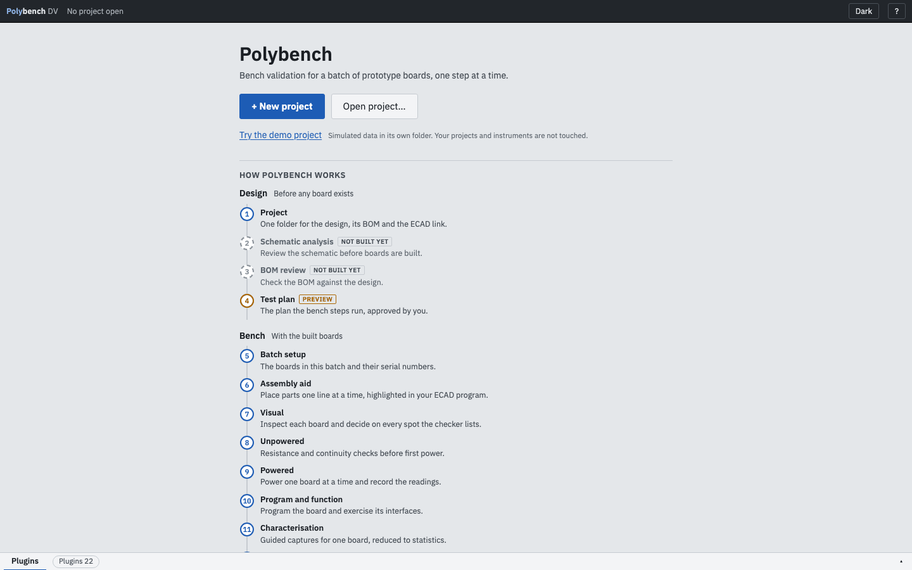

# First run with the demo

The repository ships a synthetic board, **DEMO-1**, in `src/polybench/examples/demo/`. It exercises every bench step, every test kind and every limit class. With `--simulate` you can walk the whole flow on a laptop with no hardware.

DEMO-1 is a small board with a 12 V input, a 5 V buck, a 3.3 V LDO, a microcontroller (U1), an ADC (U2), a CAN transceiver (U3), a TVS diode (D1), a tantalum capacitor (C7) and two connectors. Its part numbers are made up.

## Start it

```bash
.venv/bin/polybench lint src/polybench/examples/demo/demo.pcbv.yaml
.venv/bin/polybench --protocol src/polybench/examples/demo/demo.pcbv.yaml --simulate --batch demo-1
```

`lint` should report 0 errors. The second command prints the batch, the journal path and the URL, then opens the browser on <http://127.0.0.1:8750/>. Use `--port 8751` if 8750 is taken; Polybench never stops another program to free a port.

```text
Polybench DV  DEMO-1  batch 'demo-1'  SIMULATED
journal: ~/polybench-data/demo-1/journal.jsonl   (0 events replayed)
open http://127.0.0.1:8750/   (Ctrl+C to stop; stopping loses nothing, every value is already on disk)
```

!!! tip "The documentation's demo"
    The screenshots in this manual come from `site/examples/demo-docs/demo-docs.pcbv.yaml`. It includes the same DEMO-1 fragments and adds a test plan that generates the Unpowered and Powered steps ([step 4](../steps/test-plan.md)) and a synthetic AOI layout for [step 7](../steps/visual-aoi.md). Start it the same way with `--protocol site/examples/demo-docs/demo-docs.pcbv.yaml`.

## Start with no arguments

```bash
.venv/bin/polybench
```

With no `--protocol` and no recent project, the app opens on a welcome page instead of stopping with an error. **+ New project** opens the New project form of the Project step; **Open project...** and the recent projects open one you already have; **Try the demo project** opens the packaged DEMO-1 board in simulation. Below them, a list of the twelve steps says what each one gives you.

{ .shot loading=lazy }

The demo runs in its own folder under your user-data folder (`~/Library/Application Support/polybench/demo-project` on macOS), always simulated, with its own journal. It writes nothing to your projects or to `~/polybench-data`, and it drives no instrument and no ECAD program. The app bar shows SIMULATED and DEMO PROJECT for as long as it is open; **Back to my project** (or **Back to welcome**) returns. Once a project is open, the same list of steps stays on the Project page under **How Polybench works**.

## What `--simulate` does

- Every action uses its plug-in's simulator: realistic values, no hardware, no network.
- The ECAD bridge is simulated: it behaves like a connected ECAD program with the board open, and draws nothing.
- The batch is labelled SIMULATED in the app bar, the journal and the report. The report's readiness is HOST-ONLY.

Use a different `--batch` name for real boards. Real and simulated data never share a batch.

## A ten-minute walk

1. **Project (step 1).** The app opens here. Press **Use this document** on the active document, read the BOM cross-check and **Accept** it. See [Project](../steps/project.md).
2. **Batch setup (step 5).** Type an operator name and ten serials; Enter moves to the next box.
3. **Assembly aid (step 6).** Type `595-DEMOMCU32` in the scan box and press Enter. BOM line 1 (U1) is selected and highlighted. Press Enter on an empty box to mark the line placed on the ticked boards.
4. **Visual (step 7).** Type `y` and Enter for each check. On S02 type `n`: Enter does not record it; press **Record FAIL**.
5. **Unpowered testing (step 8).** Type `12.5`, Enter. On S03 type `0.4` for U01 and press Shift+Enter: the stop rule blocks S03.
6. **Powered testing (step 9).** Press **Read rails and current**. Four proposals arrive; press **Accept all clean for S01**.
7. **Program and function (step 10).** Press **Flash bring-up image** and watch the console. Try **Long capture (abort test)** and press **Abort**.
8. **Characterisation (step 11).** Press **Capture noise at 2 mV/V**, confirm the set-up prompt, wait for the statistics.
9. **Report (step 12).** Read the preview and press **Generate report files**.

## Stop and resume

Press Ctrl+C in the terminal. Start the same command again with the same `--batch`: every accepted value is back, because each one was on disk before the screen showed it.

## Where the files are

```text
~/polybench-data/demo-1/
  journal.jsonl        every event of the batch, one JSON object per line
  runs/                one folder per action run: evidence files, CSV of every capture
  reports/             report.md, report.html, errata_candidates.md
```

Change the base folder with `--data-dir` or the `POLYBENCH_DATA` environment variable. See [Privacy and data](../guides/privacy.md).

## Next

[The screen](screen-layout.md) explains the layout. Then try your own board: [Writing a test plan](../guides/writing-a-test-plan.md).
