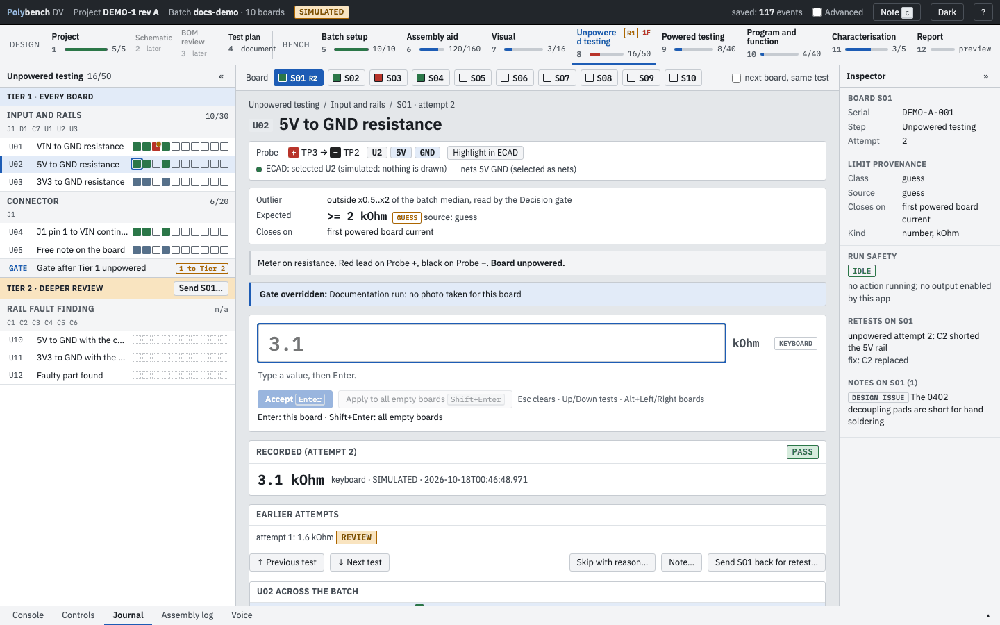
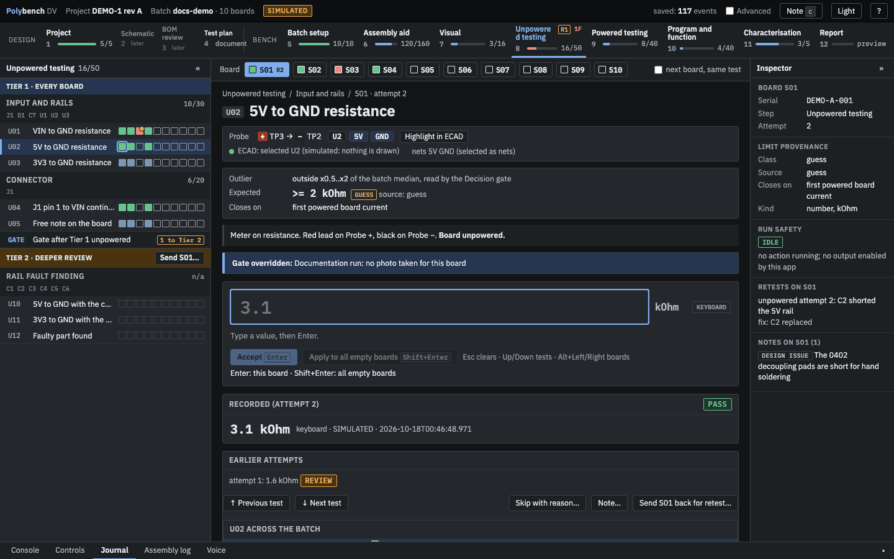
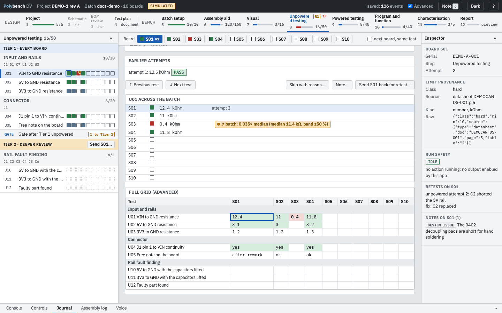
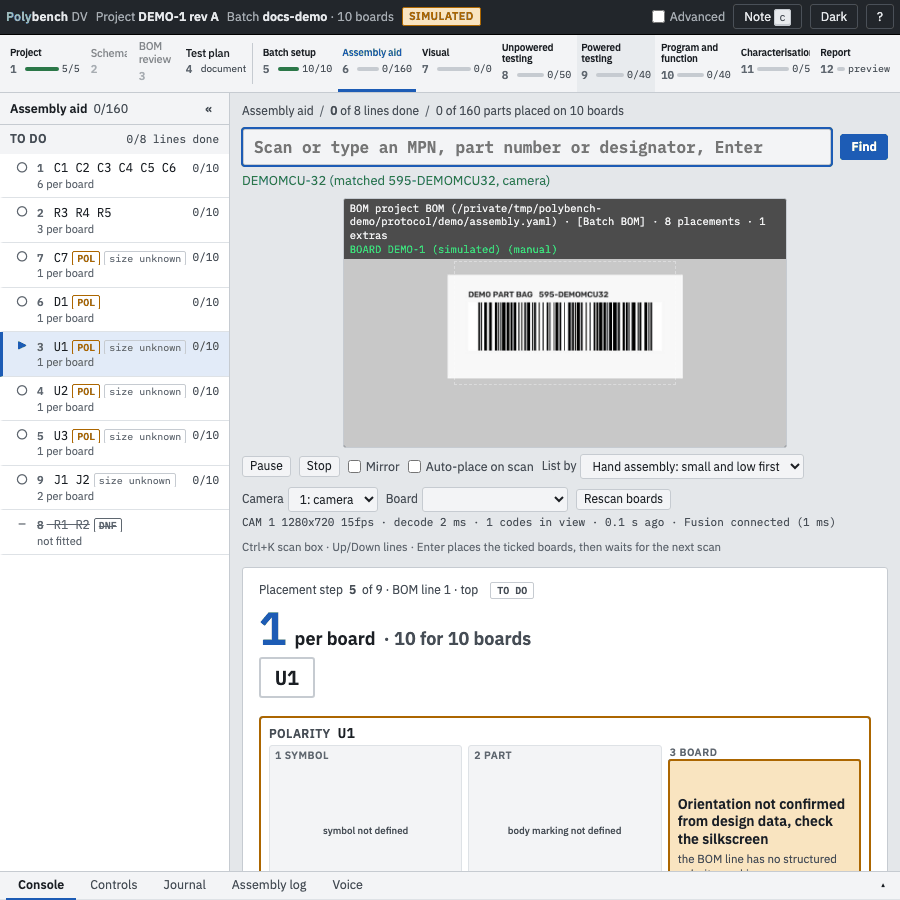
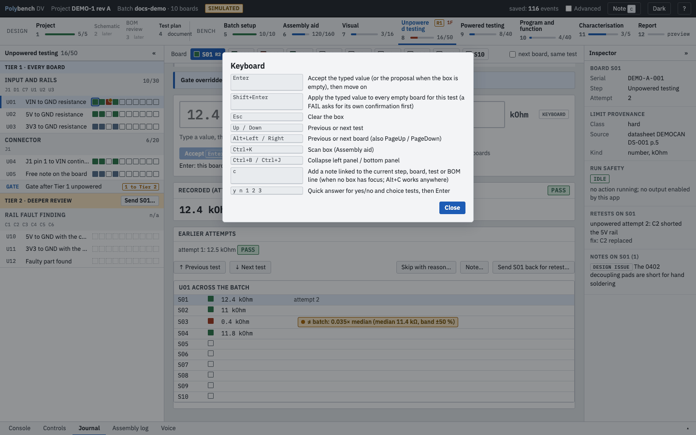

# The screen

Polybench uses a desktop workspace layout in the browser, similar to an ECAD program: navigation at the top, lists on the left, the work in the centre, details on the right and a console at the bottom. One thing is in focus at a time.

{ .shot }

## App bar

The dark bar at the very top shows the project (design name and revision), the batch and its board count. Badges appear when they matter:

| Badge | Meaning |
|---|---|
| SIMULATED | The batch was started with `--simulate`. |
| PROTOCOL CHANGED | The protocol file changed after the batch started. |
| JOURNAL WARNING | A journal line could not be read on start; hover for details. |
| SERVER NOT REACHABLE | The browser lost the server. Restart it with the same command; nothing accepted is lost. |

On the right: **saved: N events** (the journal count, updated only after each event is on disk), the **Advanced** switch, **Note** (add a note, key `c`), the light/dark theme button and `?` for keyboard help.

The theme button switches between light and dark; the choice is remembered in the browser.

{ .shot loading=lazy }

## Step timeline

The row of steps under the app bar is the main navigation. Each step shows its number, a progress bar and a count of settled cells, for example `16/50`. A red `1F` marks a step with a FAIL; an amber `R1` marks a retest. Steps 2 and 3 read "later": they are Planned. See [The twelve steps](../steps/index.md).

## Left panel

The selected step's content, in protocol order:

- section headings with a count of settled cells;
- each section's action buttons (for example **Read rails and current**);
- each test with a row of small squares, one per board: empty, green (pass or accepted), red (FAIL), amber (review) or blue (recorded, no verdict). A square with a dot holds a pending proposal.

Click a section heading (or focus it and press Enter) to fold it to its name, its count and one square per board. A section where every board passed starts folded, and the section that holds the current test is always open. Up and Down move between the tests that are showing and skip folded sections; when nothing is showing in that direction they step into the neighbouring section and open it. With more than 12 boards the squares become a bar with three counts, pass, fail and open (a test waiting for review counts as open); hover it for the words.

Ctrl+B collapses it.

## Board strip

On test steps, a row of board chips (`S01` to `S10`) sits above the centre. The chip colour follows the board's state in this step. Alt+Left and Alt+Right, or PageUp and PageDown, move between boards. Tick **next board, same test** to walk one test across all boards instead of all tests on one board.

## Centre: the focus panel

One test on one board:

- breadcrumb and title (`U01 VIN to GND resistance`);
- the **probe card**: nets and test points, **Highlight in ECAD**, and the highlight result;
- **Expected**, with the limit class badge and the source, the **Stop rule** and **Closes on** where present;
- the section's instructions;
- the large input box with the unit, and **Accept** (Enter);
- proposals, with **Accept**, **Reject** and **Accept all clean**;
- **Previous test**, **Next test**, **Skip with reason...**, **Note...** and **Send S01 back for retest...**;
- the same test across the batch, one row per board.

## Right panel: the inspector

Board serial and step, **Limit provenance** (class, source, kind) and **Run safety**: IDLE when no action runs and no output is enabled by the app. In the Visual step with AOI the right panel becomes the AOI issue checklist.

## Bottom panel

Tabs: **Console** (live output of the running action), **Controls** (running action, Abort, safe state, capabilities), **Journal** (notes, and events with the filters All, Assembly, Results, Voice and Actions), **Voice** (see [Voice](../guides/voice.md)) and **Plugins** (one entry showing the count; it turns amber when a plug-in this protocol uses is not loaded and red when one fails to import). It opens by itself when an action starts. Ctrl+J collapses it.

## Advanced

The **Advanced** switch adds the full test-by-board grid and the journal hashes. Leave it off at the bench.

{ .shot loading=lazy }

## Narrow windows

The layout works at 900 px wide, so Polybench can share the screen with the ECAD program. Panels collapse to keep the focus panel readable.

{ .shot loading=lazy }

## Keyboard help

Press `?` anywhere outside an input box. The full list is in [Keyboard](../reference/keyboard.md).

{ .shot loading=lazy }
