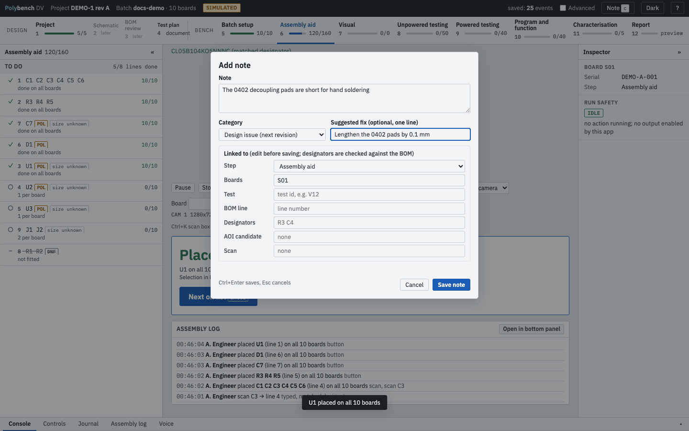
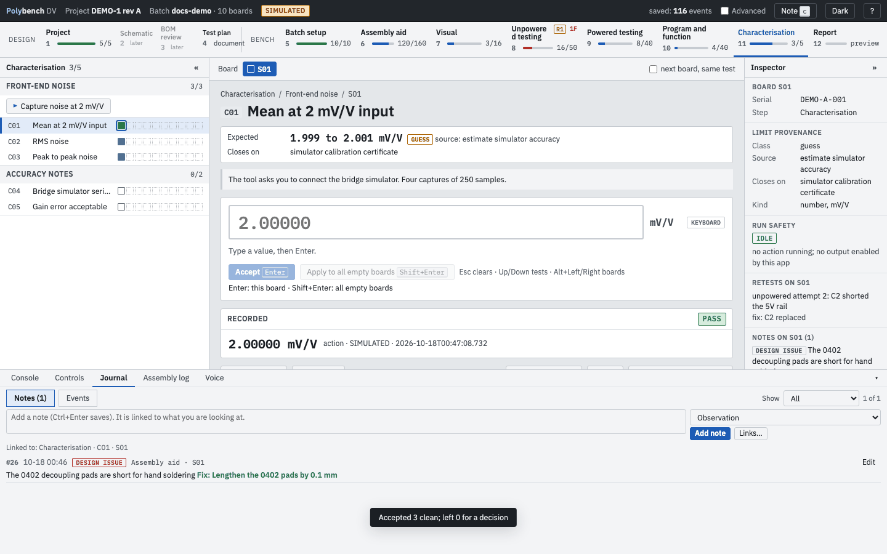

# Journal and notes

**Why:** at the bench you notice things that are not test results: a pad that is too short, a probe that slipped, a question for the designer. Written on paper they are lost; written in Polybench they are linked to the board, test or part they concern, and end up in the report and the errata candidates.

## The journal

Every batch has one append-only file, `journal.jsonl`, in its batch folder. Each line is one event, written and flushed to disk before the screen shows it as saved. The app bar's **saved: N events** counts them.

The state you see is rebuilt from the journal every time the server starts. Nothing is edited in place: a corrected value is a new `edit` event; a retest is a new attempt; a changed note is a `note_edit` event.

Event types include:

| Area | Events |
|---|---|
| Batch | `batch_created`, `boards_set`, `operator`, `serial` |
| Project | `project_select`, `bom_crosscheck`, `bom_crosscheck_accept`, `ecad_skipped`, `ecad_skip_cleared` |
| Results | `entry`, `accept` (an instrument result has `auto: true`), `edit`, `proposal`, `reject`, `skip`, `retest_open`, `gate_override`, `stop`, `stop_ack` |
| Assembly | `scan`, `placed`, `placed_batch`, `auto_cancel`, `assembly_begin`, `assembly_skip`, `assembly_unskip` |
| Actions | `action_confirm`, `action_start`, `action_end`, `safe_state` |
| AOI | `aoi_photo`, `aoi_photo_move`, `aoi_photo_removed`, `aoi_run`, `aoi_decision`, `aoi_manual_issue` |
| Notes and output | `note`, `note_edit`, `report_generated`, `errata_export` |

Each event carries a time stamp, the operator and a source (keyboard, action, AOI, operator override). Values from a simulated batch carry the origin `simulated`. The **Advanced** switch shows the journal hashes.

## Add a note

Press `c` (when no input box has focus), Alt+C (anywhere), the **Note** button in the app bar or **Note...** in the focus panel.

{ .shot }

1. Type the note.
2. Choose a **category**:

    | Category | Use for |
    |---|---|
    | Observation | What you saw |
    | Design issue (next revision) | Something to change in the design; adds a **Suggested fix** field |
    | Process | How the build or test was done |
    | Question | Something to ask |

3. Check the **Linked to** fields. They are filled from what you are looking at: step, boards, test, BOM line, designators, AOI candidate and the last scan. Edit them if needed; designators are checked against the BOM.
4. Ctrl+Enter or **Save note**. Esc cancels and keeps the draft.

## Find notes again

- A note shows on the test, the BOM line or the AOI candidate it is linked to, as a marker. A click on the marker opens the journal filtered to it.
- The **Journal** tab of the bottom panel has two views: **Notes** and **Events**. **Show** filters the notes: All, This step, This board, This test, This BOM line, This designator.
- The note box at the top of the Notes view adds a note linked to what you are looking at, without opening the dialog. **Links...** opens the full dialog.
- **Edit** on a note records a new version; the old text stays in the journal.

{ .shot loading=lazy }

## Where notes end up

- The [Report](../steps/report.md) lists every note in **Notes and comments**, grouped by step.
- **Export errata candidates** in the Report step collects every design-issue note, every FAIL with a note and every confirmed AOI defect into `reports/errata_candidates.md`.

## Related

- [Privacy and data](privacy.md): what the journal contains and where it is
- [Keyboard](../reference/keyboard.md)
