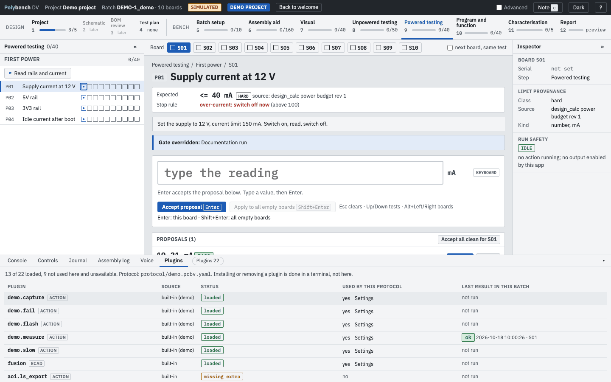

# Plug-ins and instruments

**Why:** every bench is different. Polybench keeps instruments out of its core: an action button in the protocol calls a plug-in, the plug-in talks to the instrument and proposes values, and the core decides pass or fail from the limits. Adding an instrument is a plug-in, not a change to Polybench.

## Status of the built-in plug-ins

| Plug-in | For | Status |
|---|---|---|
| `fusion` (ECAD bridge) | Autodesk Fusion: document status, designators, highlight | Hardware-validated on a real document |
| `kicad` (ECAD bridge) | KiCad 10 over its IPC API: document status, designators, highlight of parts, pads and nets. Needs the `kicad` extra | Live-tested on KiCad 10.0.7, read-only; some cases are still open |
| `altium` (ECAD bridge) | Interface only: reports "not installed" | Planned |
| `n6705b.identify` | Keysight N6705B: identify | Hardware-validated |
| `n6705b.measure`, `n6705b.first_power`, `n6705b.load_sweep` | Keysight N6705B: measure, first power, load sweep | Preview simulator only |
| `openocd.identify`, `openocd.flash` | SWD programming with OpenOCD; probe and target presets (Atmel-ICE by default) | Preview tested with a fake OpenOCD. `flash` has never flashed a board; a first real flash is planned |
| `pcan.capture`, `pcan.stats`, `pcan.query` | CAN with a PEAK PCAN-USB adapter | Preview |
| `camera.snapshot` | A photo from a USB camera as evidence | Preview |
| `aoi.run` | AOI in the Visual step | Preview |
| `demo.*` | Simulated actions for the DEMO-1 protocol | built in |

**Preview** here means tested on the host with a simulator or a fake tool, not yet run against the real instrument. The `n6705b.*` actions need the `polystage-bench` instrument library, which is not yet published.

## The Plugins tab

The bottom panel has a **Plugins** tab, and a chip beside the tab names (for example "Plugins 22") opens it. It lists every discovered action and ECAD bridge: its source (built-in, or the package and version that registered it), its status, whether the open protocol uses it, and its last result in this batch's journal (or "not run").

{ .shot loading=lazy }

- **Status** is loaded, missing extra (with the `pip` command for it, and the `pipx` form), missing library (the unpublished `polystage-bench` for the `n6705b.*` actions) or import error (with one line of the error). It comes from package metadata, an import of the plug-in's module and the journal. Opening the tab, or the welcome page, opens no port, probes no USB device, connects to no instrument and calls no ECAD program.
- **Settings** of a plug-in the protocol uses are shown read-only, with the protocol file each comes from. A value under a key containing `key`, `token`, `password` or `secret` is hidden. To change a setting, edit the protocol file.
- **Installing or removing** a plug-in is not done in the app: copy the command shown and run it in the terminal you installed Polybench with. A new install is seen after a restart.
- The chip says "N need attention" for plug-ins the open protocol uses that are not loaded. Plug-ins the protocol does not use are listed but do not raise it.

## Rules every plug-in follows

- **It proposes, never decides.** `ctx.propose(test_id, value, unit, evidence, raw)` is its only output that matters. Limits and verdicts stay in the core.
- **The protocol maps outputs to tests.** Which test receives which value is set in the action's `params` (`map: {key: test_id}`, or `propose: [{test, signal, stat}]` for the CAN actions), never in the plug-in's code. A key that is not mapped is not proposed.
- **It owns its time-outs.** There is no external kill timer. Cancel is honoured between steps.
- **It leaves the hardware safe** on every exit path, and `safe_state()` can be called on its own.
- **Evidence goes to the run folder**, named `<board>_<kind>_<timestamp>.<ext>`.
- **It has a simulator twin.** With `--simulate` it produces realistic values with no hardware and no network.

## ECAD bridges

### `fusion`

Talks to Fusion's MCP server on `http://127.0.0.1:27182/mcp` (override with `POLYBENCH_FUSION_URL`).

- `status()` names the open document, the active editor and the part count.
- `designators()` lists the parts of the active board or schematic, for the BOM cross-check.
- `highlight([...])` selects the named parts in the open Electronics document. Names not in the document come back as `missing`; net names are passed through. Only plain designator names are accepted.
- `clear()` returns Fusion to the select tool.
- It never touches a command the operator has open (it reports `busy`), and never opens, switches or saves a document.

## Power analyzer (N6705B)

Through the `polystage-bench` library, which owns the safety rules. Limits come from a DUT profile file, never from the action's params; a param may only ask for a lower current limit. Outputs are switched off and read back on every exit path. One session per action.

| Action | Params | Proposes |
|---|---|---|
| `n6705b.identify` | `map: {idn, serial}` | the identification string; read only |
| `n6705b.measure` | `channel` (1), `samples` (5), `current_unit` (`mA`), `output` (omit, `off` or `voltmeter`), `map: {voltage, current, power}` | mean voltage, current and power; changes nothing. `output: voltmeter` reads the rail a channel is wired to in voltmeter mode (needs `voltmeter = true` in the profile); `output: off` is refused as invalid when it reads 0 V, because an OFF N6781A reads 0 V |
| `n6705b.first_power` | `profile` (required on real runs), `channel`, `volts` (required), `ilim_a` (lower only), `ramp {start_v, step_v, dwell_s}`, `settle_s`, `samples`, `leave` (`off` or `on`), `map` | voltage and current after settling |
| `n6705b.load_sweep` | `profile`, `source_channel` (1), `load_channel` (2), `volts`, `points_ma` (ascending, first 0), `dwell_s`, `samples`, `settle_s`, `guard_v`, `stop_below_v`, `max_total_s` (60 at most), `map` | rail voltage at no load and full load, min and max, regulation, input current and efficiency at full load, and every point as a table and a CSV |

`first_power` sets the current limit from the profile and over-voltage protection at the lower of the profile value and the set point plus 15 %. It warns when the supply sits in current limit. `leave: on` lasts only until the profile's watchdog expires. Simulator: `sim_current_ma` sets the simulated load.

`load_sweep` powers the DUT from one channel and steps a constant-current load on the other. Everything is checked against the profile before anything is switched on, a plan longer than `max_total_s` is refused, and the rail is read in voltmeter mode on the load channel first (that is also the 0 mA point): above `guard_v` the load is not enabled. The load channel needs `voltmeter = true` in the profile. It stops with every output off if the rail falls below `stop_below_v`, a protection trips, the link fails or you cancel. Efficiency is load power over input power at each point.

## Programmer (OpenOCD)

For an Atmel-ICE and a SAM C2x target over SWD. Both actions restrict OpenOCD to the Atmel-ICE's USB ID so it never opens another USB device; `vid_pid` overrides it, and `config` replaces the interface and target scripts.

| Action | Does | Proposes (through `map`) |
|---|---|---|
| `openocd.identify` | Memory reads only; the core keeps running | probe serial, device ID, flash size, NVM user-row fields, the unique ID |
| `openocd.flash` | `program <image> verify reset` for an ELF or HEX (`.bin` is refused: no load address); requires `Verified OK` | `flashed = Y` and the image SHA-256, only after a verified flash |

Errors are in plain words: no programmer found, programmer cannot be opened, target not responding, device locked, two probes connected, OpenOCD not installed, OpenOCD timed out.

## CAN (PCAN)

python-can on a PEAK adapter. Signals are decoded from a DBC (`dbc` + `signals`) or a `decode:` list (id, start, length, byte order, sign, scale, offset, unit).

| Action | Does |
|---|---|
| `pcan.capture` | Captures for `duration_s` or `samples`, optionally after sending set-up frames; saves every frame with decoded columns as CSV; proposes per-signal statistics: `last mean std rms_noise pp min max rms n rate_hz` |
| `pcan.stats` | Noise statistics of one signal: `std`, `pp`, noise-free and effective bits against `full_scale`, windowed pk-pk (`pp_window`, `pp_window_max`), sequence gaps and repeats of a counter signal, error frames where the platform reports them |
| `pcan.query` | One request and reply, or several on one open adapter; proposes decoded values as number, hex or Y/N |

`listen_only: true` refuses to transmit. On macOS the PCBUSB driver does not report error frames, so `error_frames` is not proposed there (a zero would prove nothing). Simulator: a `sim:` param describes what a healthy board sends (rates, values, counters, dropped frames); simulated frames are decoded through the same DBC or decode map as real ones.

## Camera

`camera.snapshot` saves a JPEG from a USB camera to the run folder and proposes the file name with the path as evidence. Params: `index`, `width`, `height`, `warmup_frames`, `quality`. Needs the `camera` extra.

## Adding your own

See [Writing a plug-in](writing-a-plugin.md).
