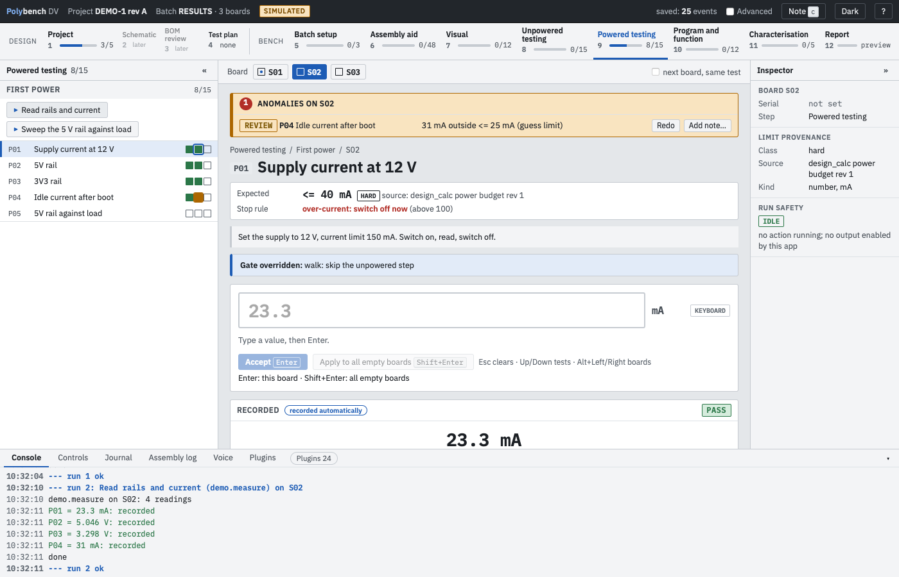
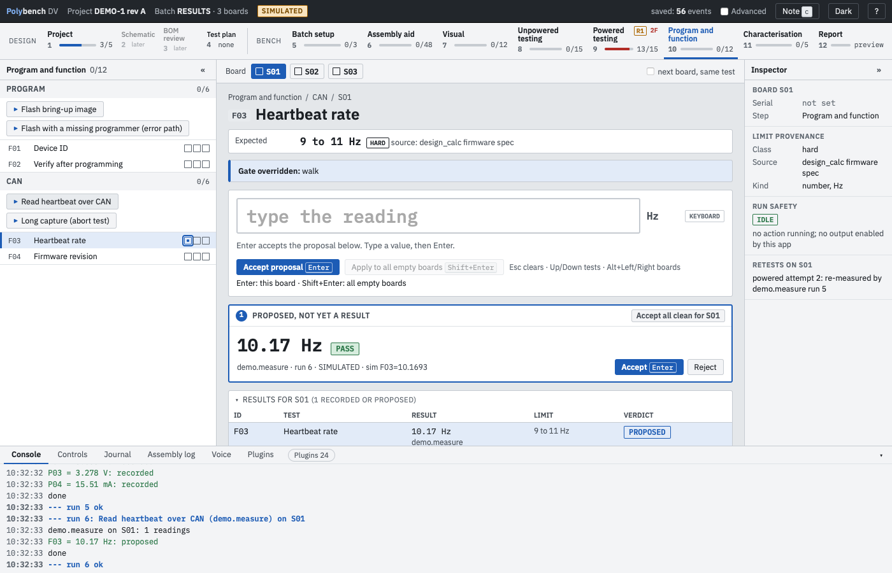
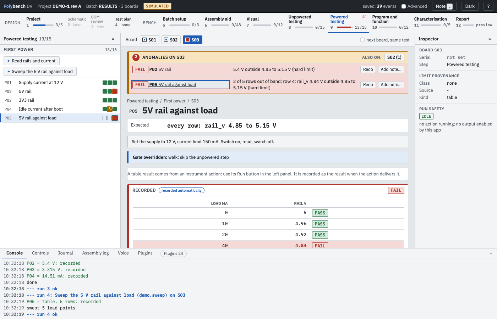

# Results and anomalies

**Why:** an instrument reading is a measurement, not a suggestion. Polybench records it in the test the moment the action delivers it, shows whether it is inside its limit, and lists anything out of band at the top of the step. You keep working; moving to the next board, or pressing **Redo**, is your answer.

## What is recorded and what is proposed

| Source | What happens |
|---|---|
| An action plug-in (instrument, programmer, bus read) | The reading is **recorded** as the result of its test, whatever its verdict. |
| Voice, the AI assistant, a local LLM | The value is **Proposed**. It is not a result until you accept it. |
| The keyboard | Recorded when you press Enter, as before. A FAIL needs **Record FAIL**. |

Every instrument result keeps its provenance in the journal: the plug-in, the run, the raw value, the evidence file and whether the run was simulated. It is a normal `accept` event marked `auto: true`, so the report and the journal show how it was recorded.

A protocol can set one action to `record: propose` when you want to look at its readings first. Those readings then wait as Proposed, with Accept and Reject.

## Reading the step

{ .shot loading=lazy }

- **Results for S02** lists every recorded test of the board in this step: value, unit, limit, verdict chip and source (instrument icon, plug-in, time). Click a row to open the test.
- **Verdict chips:** PASS, RECORD (no verdict, the limit is a record only), REVIEW (outside a guess limit), FAIL (outside a hard limit), STOP (a stop rule tripped). A TBR limit never fails a board; the reading shows in the strip with a TBR mark.
- **Anomalies** at the top of the step lists, for the current board, every REVIEW, FAIL, reading outside a guess or TBR limit, and open stop, with the reason ("31 mA outside <= 25 mA (guess limit)"). The badge counts them; the other boards with anomalies are listed beside it. Click a line to jump to the test. **Alt+A** moves the focus into the strip.
- After an action runs, the rows it recorded flash and the Results table scrolls into view.
- The strip informs. It never blocks: you can go on to the next board with anomalies open. Safety rules are separate and still apply: a stop rule stops the board until you acknowledge it, a power interlock holds the board, a step stays gated until the previous step is complete, and the decision gate still sends boards to Tier 2.

## Redo and notes

- **Redo** measures that one test again. If an action produces the test, Redo runs the action again for this board (the same as its play button, so every gate still applies); otherwise it clears the entry box and the next value you type replaces the result. The new value replaces the old one in the same attempt; the earlier value stays in the test's history and in the journal. The other tests of the step keep their results.
- **Add note** attaches a note to the test. It is optional and never blocks.
- Running an action again over a test that already holds a result does the same as Redo: the new reading replaces it in the same attempt, with the earlier value kept in the history.
- A whole-step retest (**Send back for retest**) is a separate, explicit action after rework. The power interlock needs that real retest; a Redo does not satisfy it.

## Proposed values

{ .shot loading=lazy }

A proposed value is shown large, with its verdict and source, and **Accept (Enter)** and **Reject**. **Accept all clean** takes only the proposals that pass. A proposal that is FAIL or REVIEW is accepted with its own red button.

## Table results

{ .shot loading=lazy }

A test of `kind: table` holds rows instead of one number, for example a load sweep. The protocol declares the columns and, optionally, a limit per column and a plot:

```yaml
- id: P05
  title: 5V rail against load
  kind: table
  columns: [{id: load_ma, title: Load, unit: mA}, {id: rail_v, title: Rail, unit: V}]
  limits: {rail_v: {class: hard, min: 4.85, max: 5.15, source: {type: datasheet, doc: "DEMOBUCK DS", page: 3}}}
  plot: {x: load_ma, y: rail_v}
```

Each row gets a verdict from its limits; the cell shows the worst row, with out-of-band rows highlighted and a small plot with the limit band. A plug-in delivers it with `ctx.propose_table(test_id, rows, columns)` or from a CSV file in the run folder (`csv="sweep.csv"`). The report prints one table per recorded cell. The demo project has one (`demo.sweep`, test P05).

## Journals from an earlier version

Readings that an earlier version left as proposals stay pending and can still be accepted one by one. When the board has such proposals the Proposed box also offers **Record N instrument readings**, which records them all as results at once (journal events with `via: backfill`).
