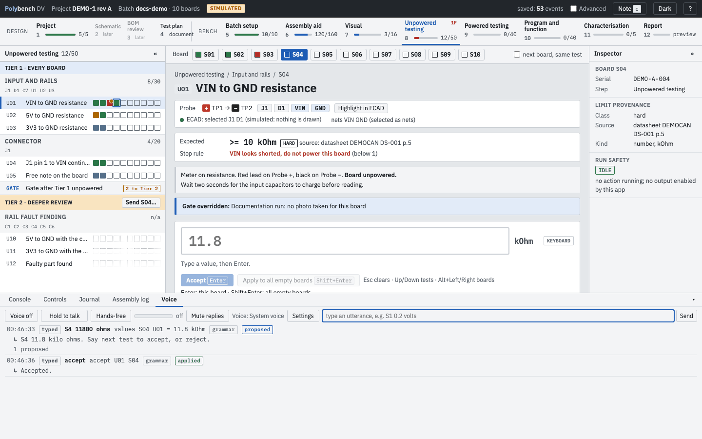
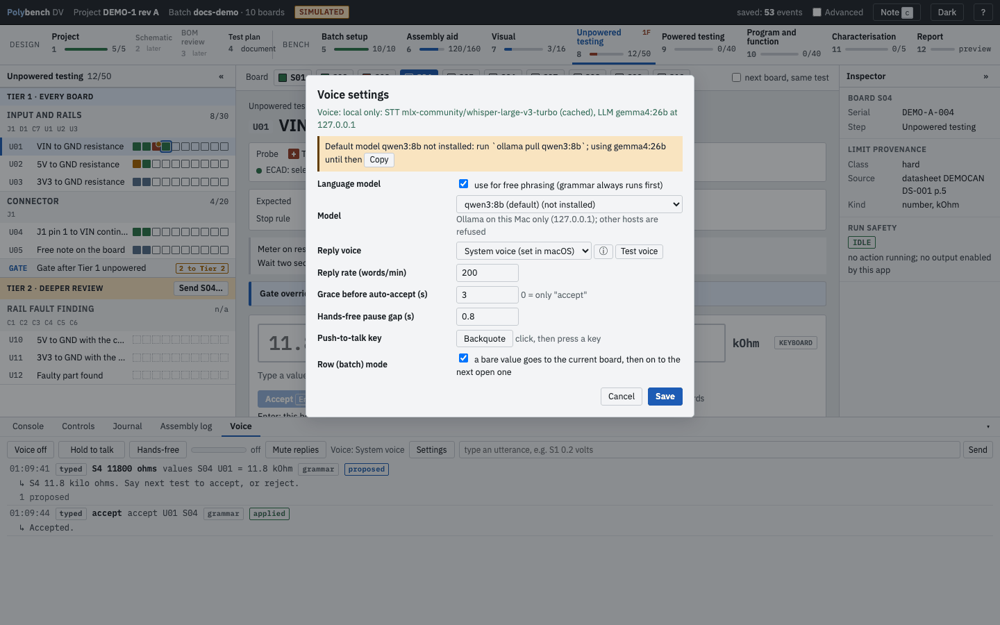

# Voice Preview

**Why:** at the bench both hands are often on probes. With voice you say "S1 0.2 volts" instead of putting a probe down to type, and Polybench answers back so you do not have to look at the screen.

!!! note "Preview"
    Voice is built and covered by automated tests, including recorded speech through the real speech-to-text model. It has not yet been run with a live microphone at a bench. Hands-free mode uses a simple energy-based voice detector: a second person talking near the microphone is not rejected.

{ .shot }

## How it works

1. You speak (push-to-talk or hands-free), or type an utterance in the Voice tab.
2. A local speech-to-text model (Whisper, through mlx-whisper) turns the audio into text.
3. A grammar reads the common phrases. Only free phrasing goes to a local language model (Ollama). Every number in the result must appear in what you said, and every board must have been spoken; an utterance without a number never yields a number.
4. Values become **proposals** on the current test, exactly like values from an instrument. Nothing is accepted until you say "accept" (or a short grace period passes for a clean PASS; see below).
5. Polybench answers by voice (macOS `say`) and records the utterance in the journal as a `voice` event, with the transcript, the route (grammar or model), the model name and the outcome.

## Install

Voice runs on macOS on Apple silicon.

1. Install the extra: `.venv/bin/pip install -e '.[voice]'` (sounddevice, mlx-whisper, NumPy).
2. The speech model (about 1.6 GB) loads only from the local Hugging Face cache. If it is missing, the Voice settings show the one command to fetch it; run it once with a network connection.
3. Optional, for free phrasing: install [Ollama](https://ollama.com) and pull the default model, `ollama pull qwen3:8b`. Until it is pulled, the best installed model is used and the settings say so. Without Ollama, voice works with the grammar alone and says so.
4. Give the terminal that runs `polybench` microphone permission (System Settings > Privacy & Security > Microphone). The microphone opens in the server process the first time you switch voice on.

## Use it

Open the **Voice** tab in the bottom panel.

| Control | Does |
|---|---|
| **Voice on / off** | Opens or closes the microphone. It is also closed while the page is hidden. |
| **Hold to talk** | Push-to-talk with the mouse. Or hold the Backquote key (`` ` ``). |
| **Hands-free** | Listens continuously and cuts utterances at pauses. |
| **Mute replies** | No spoken answers; the replies still appear in the list. |
| **Settings** | Model, reply voice and rate, grace, pause gap, push-to-talk key, row mode. |
| Text box and **Send** | Type an utterance; it goes through the same path as speech. |

Each line in the list shows the time, the source (ptt, hands-free, typed), the transcript, what was understood, the route (grammar or the model name), the outcome (proposed, applied, rejected, unclear) and the reply.

## What you can say

| Say | Does |
|---|---|
| "S1 0.2 volts", "board three two ohms", "es one 0.2 volts" | Proposes the value on that board for the current test |
| "0.2 volts" | Proposes on the current board; in row mode the cursor then moves to the next open board |
| "all boards 2 ohms", "boards one to five 3.3 volts" | Proposes on every open board of the test |
| "accept", "yes", "confirm" | Accepts the clean (PASS or record) proposals of the last utterance; a FAIL or review is held and read back |
| "accept fail" | Accepts held FAIL or review values: the deliberate FAIL |
| "reject", "scratch that" | Rejects the last utterance's proposals |
| "cancel" | Stops a grace auto-accept; the proposals stay pending |
| "skip" | Moves on without recording |
| "skip S3 reworking" | Records a skip with the reason; without a reason nothing is recorded |
| "next test", "next", "previous", "back", "test U02" | Moves to another test |
| "board S4", "next board", "previous board" | Moves to another board |
| "note R3 is 0603" | Adds a journal note linked to the step, test, board and the BOM designators named |
| "which test" | Reads the test, the probes and the expected value |
| "read out the test method", "method" | Reads the instructions, probe plus and minus, the expected value and the stop rule |
| "highlight", "show in Fusion" | Sends the test's highlight to the ECAD program again |
| "progress" | For example "U01: 4 of 10 boards done, 6 left, next S05" |
| "repeat", "say again" | Repeats the last reply |

Board words: "S1", "S01", "S 1", "es one", "board three", "boards one to five", "boards 1 and 2", up to 40 boards. Values are converted into the test's unit: "11800 ohms" on a kOhm test is proposed as 11.8 kOhm.

## Grace auto-accept

With **Grace** above zero (default 3 s), a clean PASS or record proposal is accepted that many seconds after the reply has finished, unless you say "cancel" or "reject" or press Esc first. A strip at the top of the editor counts down. Set it to 0 to accept only on "accept". Grace never applies to a FAIL, a review or a value outside a guess or tbr limit: those are read back and wait.

## Privacy

{ .shot loading=lazy }

Everything runs on your Mac. The settings show it in one line, for example "Voice: local only: STT whisper-large-v3-turbo (cached), LLM ... at 127.0.0.1".

- Speech to text runs offline: the model loads only from the local cache, and a missing model is an install hint, never a download.
- The language model address must be on the loopback interface (127.0.0.1, localhost or ::1). Any other address is refused when you save the settings and again before every call.
- Replies use the macOS `say` command.
- Each spoken clip is saved as a WAV file in the batch folder, under `voice-clips/`; transcripts are in the journal.

## Choosing a model

The default is **qwen3:8b**, a 7 to 9 billion parameter instruction model, so voice runs on modest laptops. Alternatives in the same class are `gemma4:e4b` and `llama3.1:8b`. Larger installed models can be picked in the settings, which list each with its size. The grammar handles the common commands and values without any model; the model only reads free phrasing, such as "put three point three volts on boards two through four but board five read zero point nine".

## Settings file

`~/.config/polybench/voice.json`, or the path in `POLYBENCH_VOICE_CONFIG`. Keys: `llm_enabled`, `llm_model`, `ollama_url` (loopback only), `stt_model`, `tts_enabled`, `tts_backend` (`say` or `log`), `tts_voice`, `tts_rate`, `grace_s`, `hf_gap_s`, `ptt_key`, `row_mode`, `input_device`.

## Related

- [Concepts: proposals and accepted values](../concepts.md#proposals-and-accepted-values)
- [Privacy and data](privacy.md)
- [Troubleshooting: voice](../troubleshooting.md#voice)
