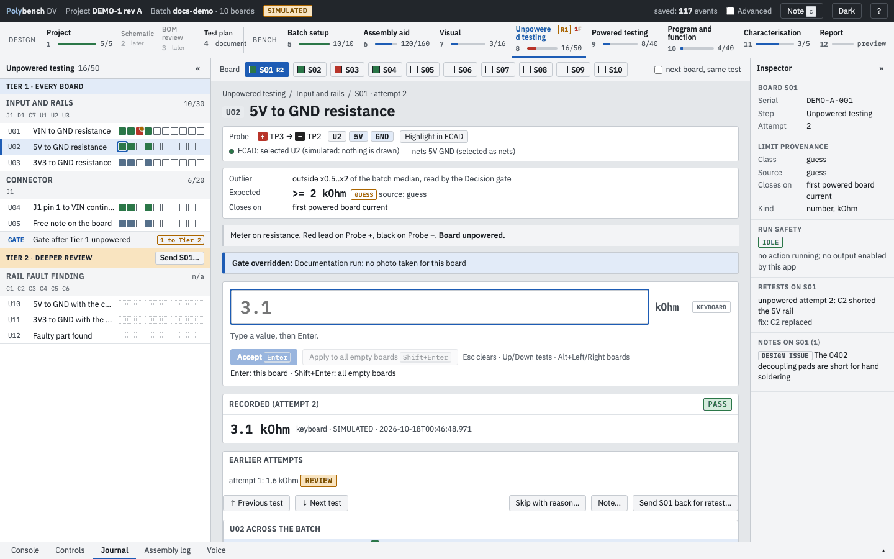
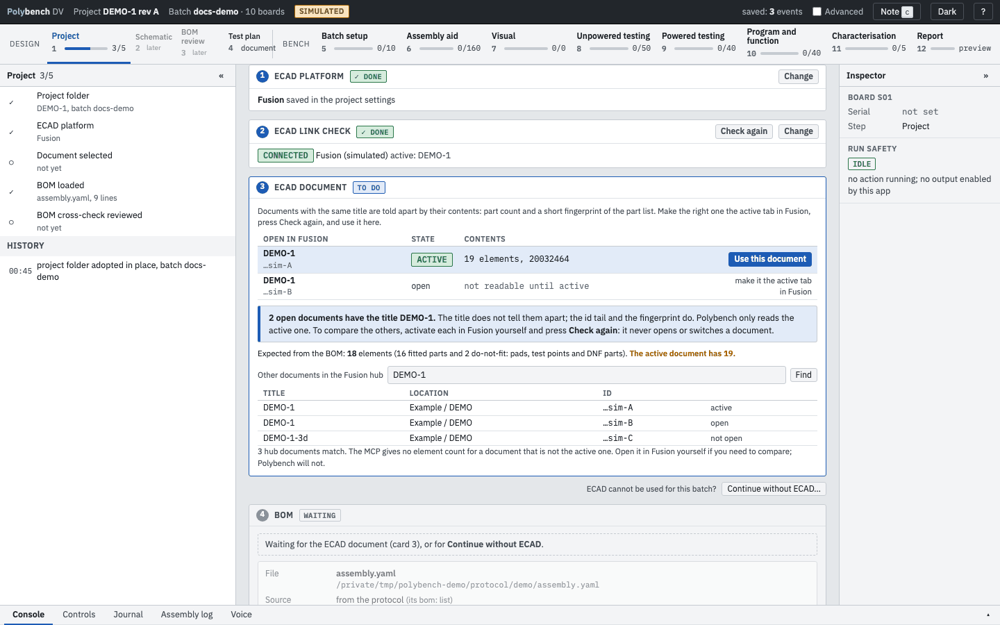
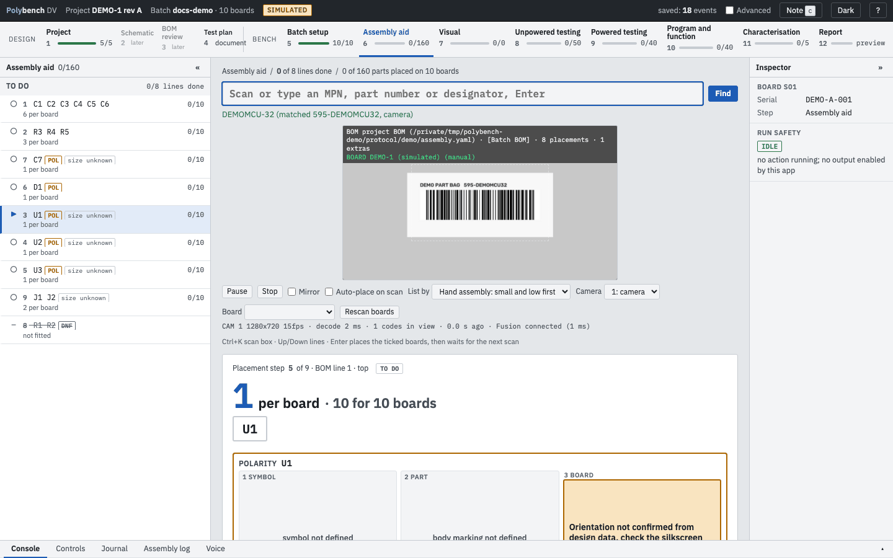
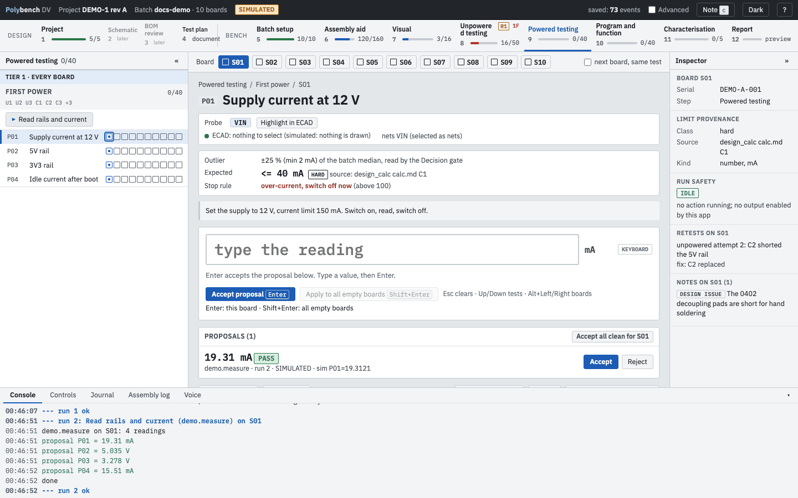

# Polybench

Polybench is a local, browser-based tool for validating electronics prototypes, from design review to bench bring-up. It runs on your laptop, opens in your browser and keeps every result on your disk.

You describe a board once, in a protocol file: its BOM, its tests, the limits and where each limit came from. Polybench then walks you and a batch of boards through the work, one step at a time, and writes a report at the end.

<figure markdown>
{ .shot }
<figcaption>The workspace: steps across the top, the step's tests on the left, one test in focus in the centre, the inspector on the right. Simulated DEMO-1 batch.</figcaption>
</figure>

## Who it is for

Hardware engineers who build and bring up small batches of prototype boards, typically 5 to 10 at a time, and who want the bench session to leave a clean, trustworthy record. One engineer runs the bench; colleagues can run steps from the same protocol file.

## The problem it solves

The first bring-up of a new board often loses more time to the test set-up than to the boards. Values typed into a spreadsheet are lost on a restart. A limit that was a guess fails a good board. An instrument is left switched on after a script crashes. Nobody can later say which reading came from which board, by which method, or against which limit.

Polybench addresses each of these:

**Nothing accepted is lost**
Every value is written to an append-only journal and flushed to disk before the screen shows it as saved. Stop the server, restart it, and the batch is back.

**Limits carry their source**
A limit is `hard`, `guess`, `tbr` or `record`. Only a hard limit, tied to a datasheet or a design calculation, can fail a board. A guess flags a value for review instead.

**One thing in focus**
One test, one board, one large input box. Type the reading and press Enter. A FAIL needs its own key, so it is never recorded by accident.

**Instruments are kept safe**
Actions run in a separate process. Abort sends a cancel, waits for the plug-in, then puts the instruments in their safe state.

**Steps across the whole batch**
All boards of the batch sit side by side. You work step by step and see at a glance which board is behind or has failed.

**Everything stays local**
The server listens on 127.0.0.1 only. Design data, photos and results stay in folders you choose. See [Privacy and data](guides/privacy.md).

## A 30-second tour

**1. Link the design.** Step 1 reads the open board from your ECAD program and cross-checks it against the BOM. Polybench only reads; it never opens, switches or edits a document. [Project](steps/project.md)

{ .shot loading=lazy }

**2. Build the boards.** The Assembly aid reads a part bag with the camera, selects the BOM line, highlights its designators in the ECAD program and counts placements across the batch. [Assembly aid](steps/assembly-aid.md)

{ .shot loading=lazy }

**3. Inspect.** Visual checks are yes/no tests. Optional automated optical inspection (AOI) lists candidate defects; you decide each one. [Visual and AOI](steps/visual-aoi.md)

**4. Measure.** Unpowered and powered tests are generated from your markdown test plan. They take typed readings or values proposed by an instrument action. A stop rule blocks a board that must not be powered, and a decision gate proposes which boards need a deeper look. [Unpowered testing](steps/unpowered-testing.md), [Powered testing](steps/powered-testing.md)

{ .shot loading=lazy }

**Or say it.** With [voice](guides/voice.md) Preview, "S1 0.2 volts" proposes a value and "accept" accepts it. Speech is recognised on your machine.

**5. Program, test functions, characterise.** Run a programmer, read a bus, capture statistics. Every result arrives as a proposal you accept. [Program and function](steps/program-and-function.md), [Characterisation](steps/characterisation.md)

**6. Report.** One click writes `report.md` and `report.html`, with retests, overrides, open items and a readiness label per step. Notes tagged as design issues become errata candidates for the next revision. [Report](steps/report.md)

## What is ready, what is not

Polybench is at version 0.1.0. The bench steps (5 to 12) and step 1 are built and tested. Some parts are marked on their pages:

- Preview built and covered by automated tests, not yet used on a real batch: the [test plan as master](steps/test-plan.md) with tiers and a decision gate, [voice](guides/voice.md) input, and several instrument plug-ins (each plug-in's status is in [Plug-ins and instruments](guides/plugins.md)).
- Planned not built yet: step 2 Schematic analysis, step 3 BOM and manufacturing, drafting the test plan from the schematic and layout, the Altium bridge.
- Preview also: the optional AI connector (an MCP server; tested with Claude Code on a simulated batch, Codex unverified) and the experimental AOI diff mode, which needs no layout and has no measured detection rate.
- Plug-ins that have not touched real hardware, such as the OpenOCD flash plug-in and the ESP32-S3 demo on a real board, are planned for a real run and are labelled on the plug-in page.

## Where to start

1. [Install](getting-started/install.md) Polybench and run the self-test.
2. [Check the bench](getting-started/doctor.md) with `polybench doctor`.
3. [Run the demo](getting-started/first-run.md) board with `--simulate`. No hardware is needed.
4. Read [Concepts](concepts.md), then [write a test plan](guides/writing-a-test-plan.md) for your own board.
