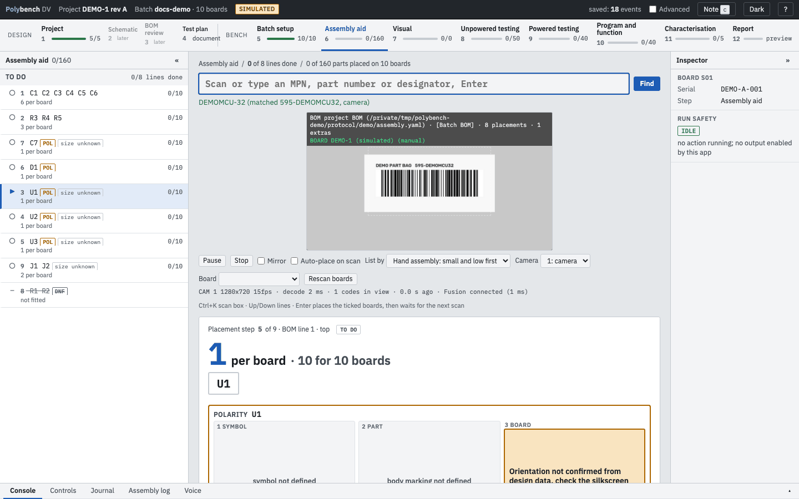
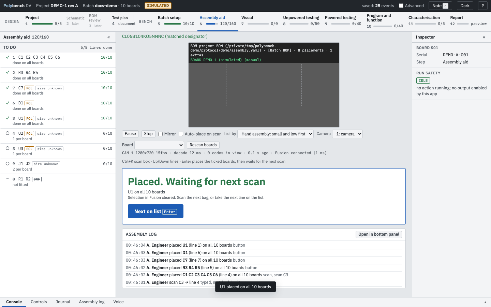
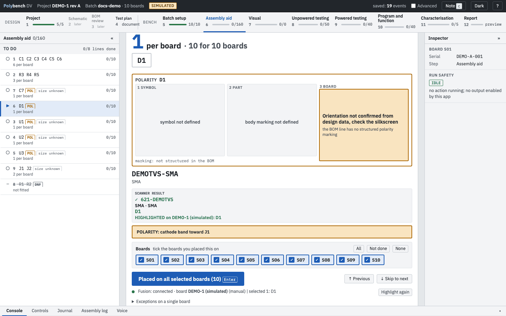

# Step 6: Assembly aid Ready

**Why:** hand-assembling a batch is a long run of "which part is this, where does it go, which way round, did I do all ten boards". The Assembly aid answers each question from the design data and counts placements across the batch, so nothing is missed and nothing is fitted twice.

{ .shot }

## The start page

A batch with no placements opens on a short start card: an icon, one line (*Scan a component bag and see where it goes on your board in Fusion. Needs a matched BOM.*, with the name of the ECAD program the project uses) and two buttons. **Assemble** starts the aid. **Boards are already built, skip** records that this batch is not assembled here. Until you press Assemble nothing else happens: the camera stays off and no scanner is started. If you skip, coming back to the step shows *Skipped (boards already built)* with **Assemble instead**, so you can change your mind. Assemble, skip and reversing the skip are all written to the journal; no placement is ever removed by them. Skipping is offered only before the first placement or scan.

## The screen

- **Left: the to-do list.** One row per BOM line: line number, designators, how many per board and progress across the batch (`0/10`). Badges: **POL** for a polarised part, **DNF** for a do-not-fit line (struck through, at the bottom), **size unknown** when the line has no hand-assembly size hints.
- **Centre, top: the scan box** and the camera view. Type or scan an MPN, a supplier part number or a designator.
- **Centre, below: the current line.** The placement step, the large count per board and for the batch, the designators, the MPN with value and package, the scanner result and the ECAD highlight result.
- **Polarity card** for polarised lines (see below).
- **Board ticks** and **Placed on all selected boards**.
- **Assembly log**: the last scans and placements with who and when. **Open in Journal** opens the Journal on its Assembly filter, which lists all of them.
- **The protocol's assembly checks**, if it declares any (paste print, placement check, reflow and the like), are listed in build order: groups marked `position: before_placement` above the to-do list, the rest below it. Group headings fold; a group where every board passed starts folded. See the [protocol file](../reference/protocol.md).

## How to

1. **Pick the next part.** Scan the bag label with the camera, scan it with a keyboard-wedge barcode reader into the scan box, or type an MPN or designator and press Enter. **Next on list** (Enter on an empty page) takes the next line in list order.
2. **Find it on the board.** The line's designators are selected in the ECAD program, so the board view shows where they go. The result reads, for example, `HIGHLIGHTED on DEMO-1: C1 C2 C3 C4 C5 C6`.
3. **Check orientation** on the polarity card for a POL line.
4. **Place the parts** on the boards.
5. **Tick the boards you placed this on** (every board that does not have the line yet is ticked by default) and press **Placed on all selected boards** or Enter. The line's count goes up on each ticked board and the app waits for the next scan.
6. For one board that differs, open **Exceptions on a single board** and click designators to mark them placed or not placed on that board alone.

{ .shot loading=lazy }

## The camera scanner

The camera view decodes Code 128 barcodes, the kind on distributor bag labels. A decoded code is resolved against each BOM line's `barcode:` list, its MPN and its designators, and selects the matching line. The status line under the camera shows the camera, frame rate, decode time, codes in view and the ECAD link.

| Control | Does |
|---|---|
| **Pause** / **Stop** | Pause decoding, or stop the camera |
| **Mirror** | Mirror the image (for a camera facing you) |
| **Camera** | Choose the camera |
| **Board** | Choose which open ECAD board receives the highlights; **Auto** picks the board that holds the designators |
| **Rescan boards** | Read the list of open ECAD boards again |

The camera is released when you leave the step. The scanner needs the `scanner` extra; see [Install](../getting-started/install.md#extras).

## List order

**List by** changes only the order of the to-do list. Placements, the log and the protocol are untouched, and the choice is remembered.

| Order | Puts first |
|---|---|
| Hand assembly: small and low first | Passives and low parts; ICs, crystals and inductors last; DNF at the bottom. Uses `height_mm` and `body_mm` on the BOM line when present, otherwise the package. |
| Protocol order | The BOM's `order:` field |
| Designator | Natural designator order (C2 before C10) |
| Most remaining | The lines with the most placements still to do |

## Auto-place on scan

With **Auto-place on scan** ticked, scanning the next bag means "done with the previous one". The new line becomes current at once; the previous line is placed on its ticked boards after a 3-second grace. Esc cancels within the grace, and the log records the cancel.

## Polarity card

For a polarised line the card shows three panels: **1 Symbol** (the schematic symbol), **2 Part** (the part from above with its body marking) and **3 Board** (the footprint at its real rotation and side with the polarity pad highlighted), plus one line of text.

The card is drawn only from design data. Polybench reads the placed footprint from the ECAD program, proves its rotation, mirror and side against the program's own pad positions, and finds the polarity pad from structured marking data on the BOM line (`polmark:`). When any link in that chain is missing or disagrees, the card turns amber and the board panel reads **"Orientation not confirmed from design data, check the silkscreen"** with the reason.

{ .shot loading=lazy }

The DEMO-1 BOM carries only free-text `polarity:` notes and no `polmark:`, so its cards are amber, as above. See [Protocol file: polarity marking](../reference/protocol.md#polarity-marking-polmark) for the fields.

Good reads are cached per document in the batch folder, so the card still works when the ECAD program is briefly unreachable; the source line then says `[cached read]`.

## Keys

| Key | Does |
|---|---|
| Ctrl+K | Jump to the scan box (from any step) |
| Enter in the scan box | Resolve the scan; on an empty box, place the current line on the ticked boards |
| Up / Down | Previous or next line |
| Any character | Starts typing in the scan box |
| Esc | Cancel an auto-place grace |
| `c` | Add a note linked to this BOM line and its designators |

## What is recorded

Every scan (code, how it matched, which line), every placement and clear (designators, boards, via scan, list or key), and every auto-place cancel. The Journal's **Assembly** filter in the bottom panel lists them, together with the start, skip and reverse of the aid.

## Related

- [Project](project.md): the ECAD link the highlights use
- [Journal and notes](../guides/journal-and-notes.md): notes on a BOM line feed the errata candidates
