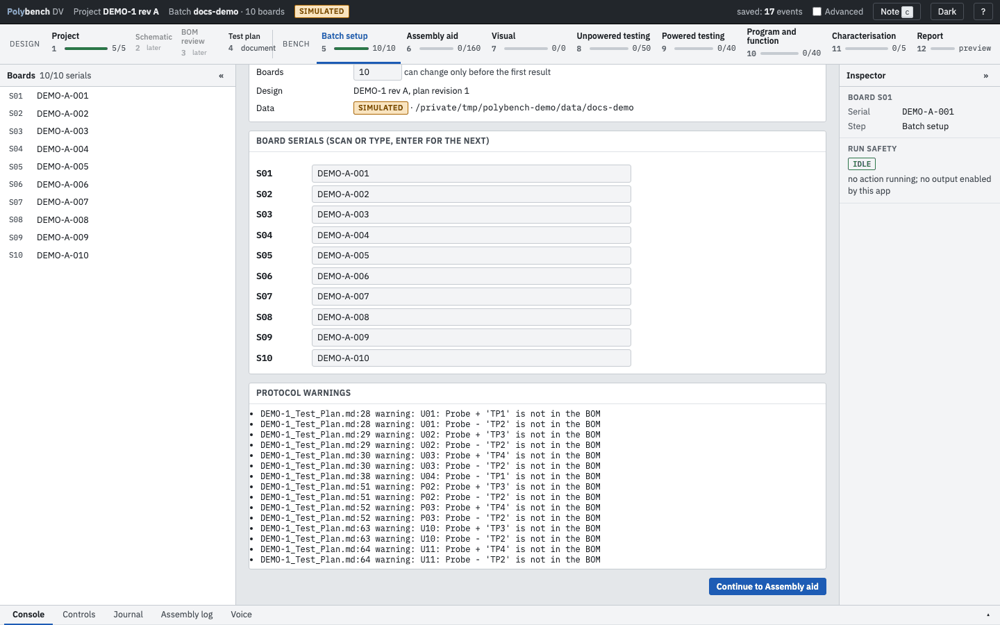

# Step 5: Batch setup Ready

**Why:** every result must be tied to a physical board. Batch setup fixes who is working, how many boards there are and which serial sits in which slot, before the first value is recorded.

{ .shot }

## How to

1. **Operator.** Type your name. It is recorded with every result. You can also pass it on the command line: `--operator "A. Engineer"`.
2. **Boards.** Check the board count. The default comes from the protocol (`batch.default_boards`) or `--boards N`. The count can change only until the first result is recorded.
3. **Serials.** Scan or type each board's serial or batch label. Enter moves to the next box, so a barcode scanner that sends Enter fills the list in one pass.
4. Press **Continue to Assembly aid**.

Board labels are the protocol's prefix plus a number: `label_prefix: S` gives `S01` to `S10`. The label is what you write on the board; the serial is what the board or its label carries.

## The batch folder

The **Data** line shows where this batch lives, for example `~/polybench-data/DEMO-B1`, and the SIMULATED badge when the batch was started with `--simulate`. Everything for the batch is in that folder. See [Privacy and data](../guides/privacy.md#what-is-stored-where).

## Keys

| Key | Does |
|---|---|
| Enter in a serial box | Save and move to the next board |
| Tab | Next field |

## Related

- [Concepts: batches and boards](../concepts.md#batches-and-boards)
- [Assembly aid](assembly-aid.md), the next step
