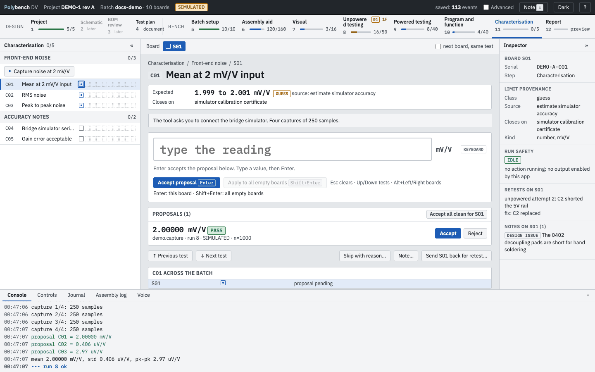
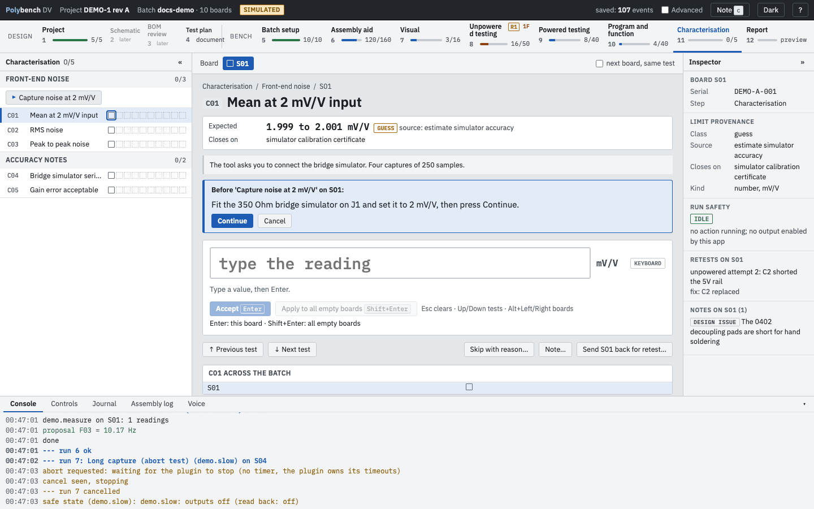
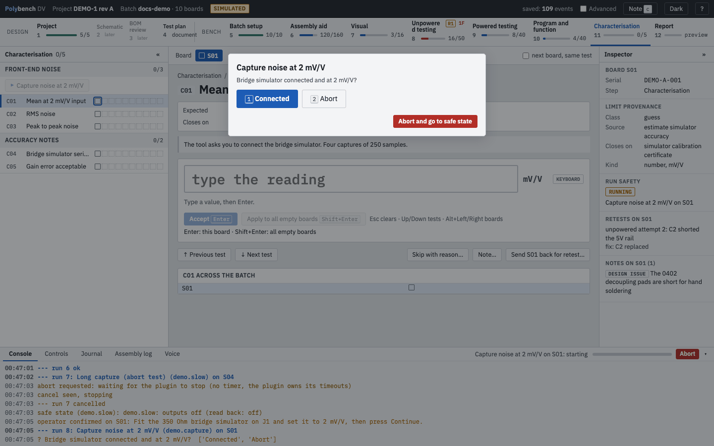

# Step 11: Characterisation Ready

**Why:** pass/fail tests say the board works; characterisation says how well. It is usually run on one board of the batch, as a guided procedure: set up, capture, reduce to statistics, accept.

{ .shot }

## How to

1. The step usually applies to one board (`applies_to: [S01]` in the protocol). It is gated on Program and function.
2. Press the capture action, for example **Capture noise at 2 mV/V**.
3. Polybench first shows the set-up the action needs ("Fit the 350 Ohm bridge simulator on J1 and set it to 2 mV/V, then press Continue."). Nothing runs until you press **Continue**.

    { .shot loading=lazy }

4. While it runs, the action may ask a question. Answer with the button or its number key.

    { .shot loading=lazy }

5. The action reduces the captures to statistics and proposes them on the step's tests. Accept them, or **Accept all clean for S01**.
6. Record the context by hand: the instrument serial number (text), and a yes/no judgement where the protocol asks for one.

## Limits during characterisation

Characterisation limits are often not known yet. DEMO-1 shows the three useful classes: the mean against a **guess** that closes on the simulator's calibration certificate, the RMS noise against a **tbr** limit that closes on the datasheet table plus the first capture, and the peak-to-peak noise as **record** only.

## Statistics

For CAN-based captures, `pcan.stats` and `pcan.capture` follow the ADC datasheet convention: `std` is the sample standard deviation, `pp` is max minus min over the whole capture, noise-free bits are log2(full scale / pp) and effective bits are log2(full scale / rms noise). The windowed pk-pk (`pp_window`) is the mean of consecutive non-overlapping blocks, the figure a datasheet table usually quotes. See [Plug-ins and instruments](../guides/plugins.md#can-pcan).

## Related

- [Concepts: limit classes](../concepts.md#limit-classes)
- [Report](report.md), the next step
