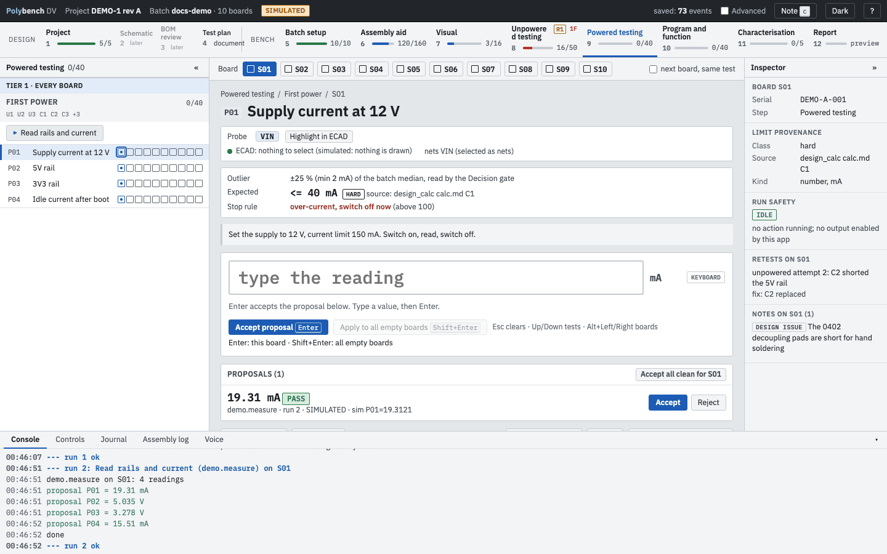
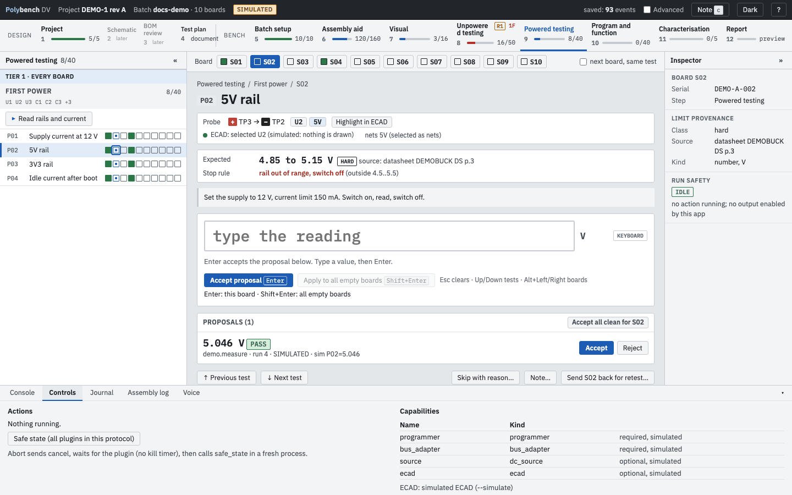

# Step 9: Powered testing Ready

**Why:** first power is the riskiest minute of a bring-up. The step keeps it short and controlled: a set procedure, current limits from the protocol, and readings that are either typed or delivered by the power analyzer, never guessed.

{ .shot }

## Scope

Powered testing proves the supply: first power, idle input current with the MCU blank or in reset, every rail in band, a soak, and the supply under load. It ends with a board that is safe to program. Bus levels, sensor front ends and the current in each operating mode need firmware, so they belong in [Program and function](program-and-function.md). See [Writing a test plan, section 1a](../guides/writing-a-test-plan.md#1a-put-each-test-in-the-right-step).

## How to

1. Pick the board. The step is gated on Unpowered testing and, when the plan's gate holds power, on the [power interlock](unpowered-testing.md#retest-and-the-power-interlock).
2. Read the section's instructions, for example "Set the supply to 12 V, current limit 150 mA. Switch on, read, switch off."
3. Either type each reading and press Enter, or press the section's action button (**Read rails and current** on DEMO-1). The bottom panel opens and streams the action's output.
4. The action's readings are **recorded** on their tests as they arrive, each with a verdict chip and its source. Nothing needs accepting. A reading outside its limit is listed in the **Anomalies** strip at the top (see [Results and anomalies](../guides/results-and-anomalies.md)); it does not block you. Move on, or press **Redo** on it to measure again.
5. Press **Redo** on a reading to measure that one test again: the action runs again (all gates apply) or, for a typed test, the entry box clears. The new value replaces the old one in the same attempt and the earlier value stays in the history; the other tests of the step keep their results. A whole-step retest is a separate, explicit action.
6. Values from voice or the AI assistant arrive as **Proposed**: **Accept** (Enter) or **Reject** them, or **Accept all clean for S01**.

## Tests from the plan

With a generated plan, Tier 1 Powered runs **board by board**: all powered tests on one board, then the next board, so each board is powered once. The tests, limits, stop rules and the Run buttons (the plan's `Actions:` line) come from the plan; see [Writing a test plan](../guides/writing-a-test-plan.md).

## Stop rules at power

DEMO-1's P01 has the stop rule `above 100`: above 100 mA the board is blocked with "over-current: switch off now". Switch off first, then acknowledge with a reason.

## Instruments

With a Keysight N6705B and the instrument library installed, the `n6705b.first_power` action ramps the output to the set voltage under the current limit and over-voltage limit from a DUT profile, settles, reads voltage and current, and switches the output off (unless the protocol says `leave: on`). `n6705b.measure` reads without changing anything. Outputs are switched off and read back on every exit path: done, error, cancel or Abort. See [Plug-ins and instruments](../guides/plugins.md#power-analyzer-n6705b).

No instrument? Use a bench supply and a meter and type the readings. Manual entry always works.

## Controls and Abort

The **Controls** tab of the bottom panel shows the running action, **Abort and go to safe state**, **Safe state (all plugins in this protocol)** and the capabilities the protocol declares. The inspector's **Run safety** box reads IDLE when no action runs and no output is enabled by the app.

{ .shot loading=lazy }

Abort sends a cancel to the plug-in, waits for it to stop (each plug-in owns its time-outs; there is no kill timer), then calls the plug-in's safe state in a fresh process and reports the result.

## Related

- [Program and function](program-and-function.md), the next step
- [Writing a plug-in](../guides/writing-a-plugin.md): how actions propose values
