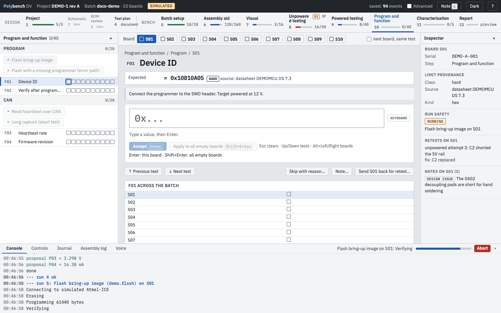
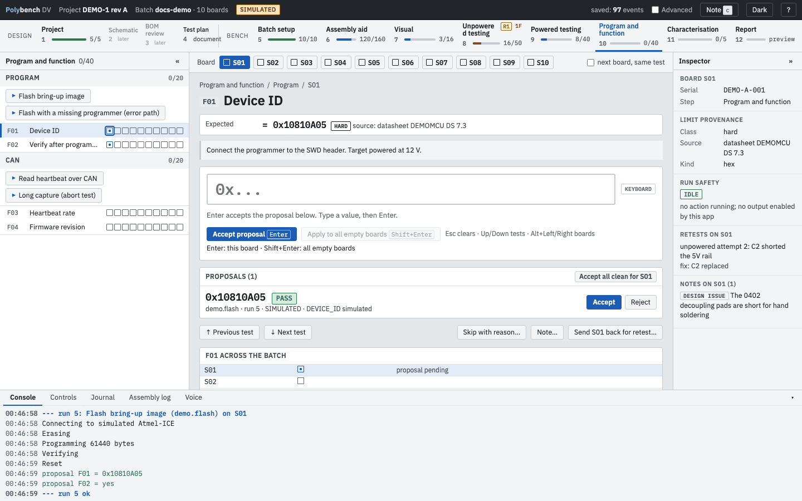
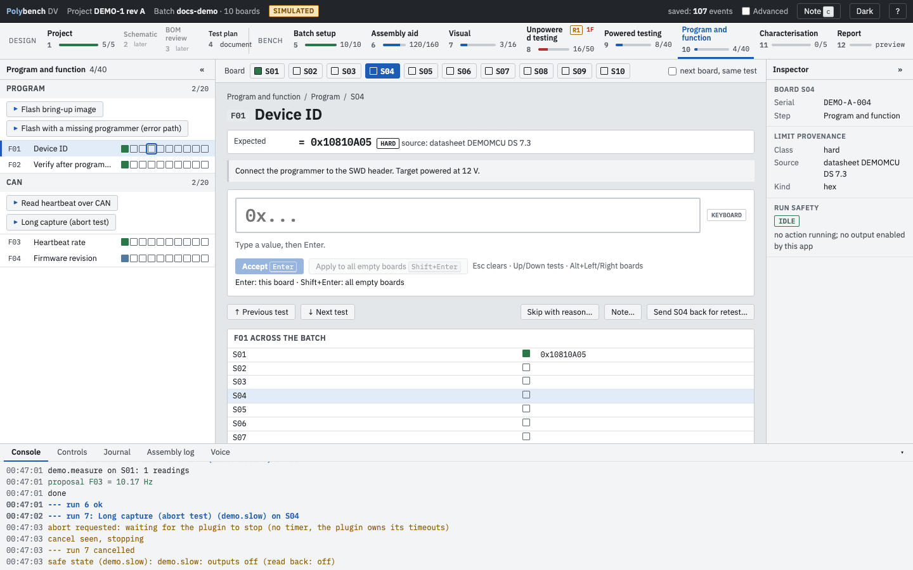

# Step 10: Program and function Ready

**Why:** a board is not working until its firmware is on it and every function it has has been exercised. Polybench has no built-in idea of what your board does: each interface (a CAN bus, a sensor, a motor driver) is a section of the protocol with its own actions and tests.

This step starts on a board whose supply and rails passed Powered testing. It holds every test that depends on firmware: bus idle levels and traffic, each sensor or interface, and the current in each operating mode.

{ .shot }

## How to

1. Pick the board. Connect the programmer or the bus adapter as the section's instructions say.
2. Press a section's action, for example **Flash bring-up image** or **Read heartbeat over CAN**. It runs on the current board.
3. Watch the **Console**. A progress bar shows in the bottom tab bar while the action runs.
4. Its readings are recorded on the tests it names as they arrive (see [Results and anomalies](../guides/results-and-anomalies.md)). An action set to `record: propose` leaves them as proposals to accept, as in [Powered testing](powered-testing.md).

{ .shot loading=lazy }

Some actions first ask you to confirm a set-up step (**Continue** / **Cancel**), or ask a question while they run, with numbered answers (keys `1`, `2`, ...).

## Abort

Press **Abort** in the bottom bar when an action hangs or looks wrong. Polybench sends a cancel, waits for the plug-in to stop and then puts the instruments in their safe state. The console shows each stage.

{ .shot loading=lazy }

An action that fails shows ERROR in the console with a plain-language reason ("No programmer found", "Target not responding", "No CAN frames received"). The app keeps working; you can retry, type a value or skip with a reason.

## Typical actions

| Action | Does | Proposes |
|---|---|---|
| `openocd.identify` | Reads the device over SWD with OpenOCD (memory reads only) | probe serial, device ID, flash size, NVM fuses, unique ID |
| `openocd.flash` | Programs an ELF or HEX image and verifies it | `flashed = Y` and the image SHA-256, only after a verified flash |
| `pcan.capture` | Captures CAN frames for a time or a sample count, decodes signals from a DBC or a decode map | per-signal statistics (last, mean, std, pk-pk, rate and more) |
| `pcan.query` | Sends a request and waits for the reply, or several in one session | decoded values, as number, hex or Y/N |
| `pcan.stats` | Noise statistics of one signal | std, pk-pk, noise-free and effective bits, sequence gaps |

The full parameter lists and each plug-in's readiness are in [Plug-ins and instruments](../guides/plugins.md). The DEMO-1 protocol uses built-in `demo.*` actions that simulate the same flow without any hardware.

## Related

- [Writing a plug-in](../guides/writing-a-plugin.md)
- [Troubleshooting: programmer and CAN](../troubleshooting.md#programmer)
