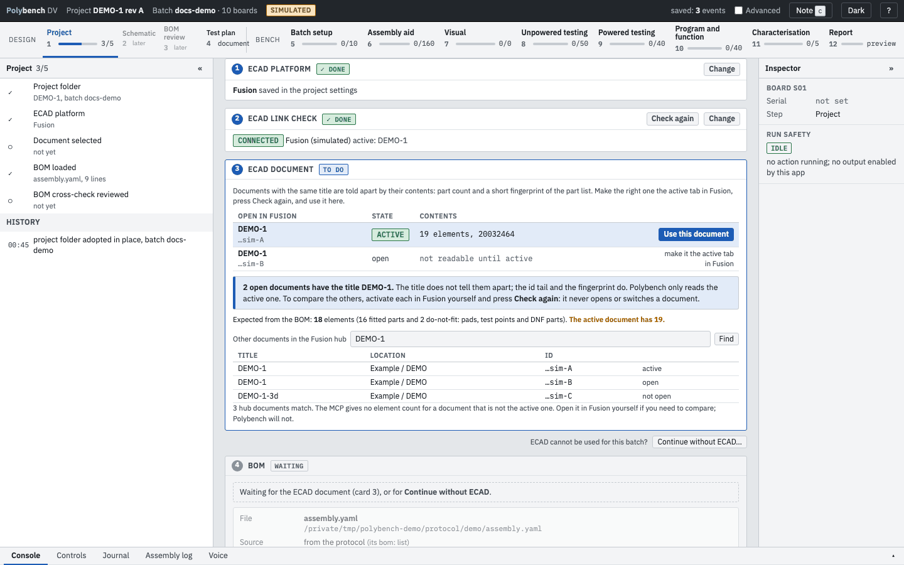
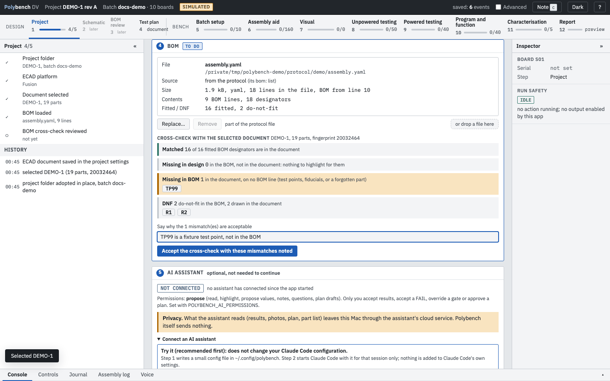

# Step 1: Project Ready

**Why:** every highlight, polarity card and BOM check later on depends on reading the right board. Step 1 makes sure Polybench reads the document you think it reads, and that the design and the BOM agree.

The app opens on this step until the batch has a project.

{ .shot }

## What Polybench does and does not do

Polybench only **reads** from the ECAD program. It never opens, switches, saves or changes a document. When you need a different document, you make it the active tab yourself and press **Check again**.

The Project page lets you choose the ECAD platform: Autodesk Fusion, through its local MCP server, or KiCad 10, through its IPC API (tested live on KiCad 10.0.7, read-only). Switching platform clears the document recorded with the other one and asks you to confirm again. The Altium bridge exists as an interface only and is Planned. See [Plug-ins and instruments](../guides/plugins.md#ecad-bridges).

## How to

The page is a column of numbered cards, each with a DONE, TO DO or WAITING marker.

0. **Project folder.** Shows the project, the batch folder, the journal, the settings file and the protocol, each with **Copy** and **Show in Finder**, and the batches already in the project. **New project...** and **Open project...** switch to another folder; opening an older batch folder adopts it in place and writes a settings file next to it, nothing is moved.
1. **ECAD platform.** Fusion or KiCad, saved in the project settings. **Change** switches it.
2. **ECAD link check.** Shows the link (CONNECTED or not), the program and the active document. If the link is down, the card shows a guided set-up; fix it and press **Check again**.
3. **ECAD document.** Open the board in the ECAD program and make its Electronics tab the active one. Documents with the same title are told apart by their part count and a short fingerprint of the part list. Press **Use this document** on the right row. Rows that are open but not active read "not readable until active".
4. **BOM.** Shows the file, where it came from (the protocol's `bom:` list or a file chosen for this project), its size and its counts. **Replace...** or **+** chooses another file, or drop one on the card. Under it, read the **cross-check with the selected document**: matched, missing in the design, missing in the BOM, and do-not-fit parts. "Expected from the BOM: 18 elements (16 fitted parts and 2 do-not-fit)" against "The active document has 19" tells you there is one extra part, for example a test point.
5. **Accept the cross-check.** With mismatches, type why in the note box first ("TP99 is a fixture test point, not in the BOM"); the button reads **Accept the cross-check with these mismatches noted**.

The last card, **AI assistant**, is optional and gates nothing; see [Plug-ins and instruments](../guides/plugins.md).

{ .shot loading=lazy }

Step 1 is complete when the ECAD program is linked, a document is selected and the cross-check is reviewed. The left panel ticks the five items (folder, platform, document, BOM, cross-check) and keeps a history of each selection.

## No ECAD program today

Press **Continue without ECAD...** and type a reason ("ECAD not installed on this laptop"). The step completes, highlights are off, and manual entry works everywhere. **Link ECAD again** undoes it.

## What is recorded

The selected document (name, element count, fingerprint), the cross-check result with your note, or the reason for continuing without ECAD. All are journal events, so they survive a restart and appear in the report.

## Related

- [Assembly aid](assembly-aid.md) uses the link to highlight designators and draw polarity cards.
- [Troubleshooting: the ECAD program does not highlight](../troubleshooting.md#the-ecad-program-does-not-highlight)
