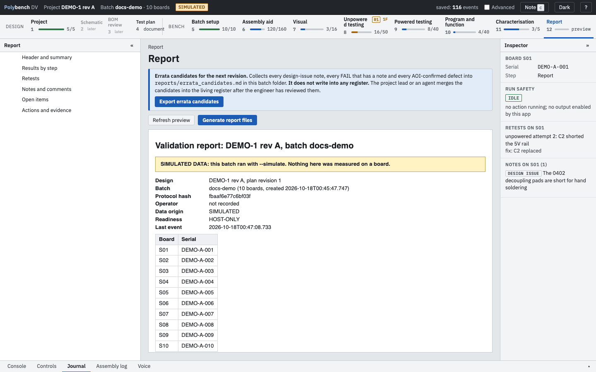
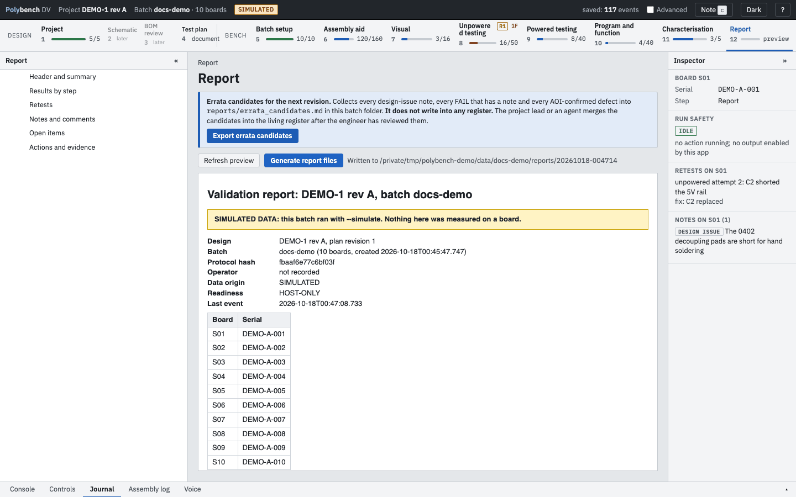

# Step 12: Report Ready

**Why:** a bring-up is only as useful as the record it leaves. The report is generated from the journal, so it says exactly what was measured, on which board, against which limit, what was retested and what is still open, without anyone retyping a value.

{ .shot }

## How to

1. Open the Report step at any time; the preview is live. **Refresh preview** updates it.
2. Press **Generate report files**. Polybench writes `report.md` and `report.html` to the batch's `reports/` folder and shows where.
3. Press **Export errata candidates** to write `reports/errata_candidates.md` (see below).

The left panel jumps to each section.

## What the report contains

| Section | Contents |
|---|---|
| Header and summary | Design and plan revision, batch, protocol hash, operator, data origin (SIMULATED or measured), overall readiness, last event; the board and serial table; the ECAD document and BOM cross-check from step 1; a board-by-step summary (PASS, FAIL, REVIEW, PASS after retest, partial, n/a); readiness per step |
| Results by step | One table per step: test, title, expected value and each board's result with its marks. Tests no board ran are left out. The Assembly aid lists placed designators per board. |
| Retests | Each retest with board, step, attempt, cause and fix, and the earlier results |
| AOI | Run, photos, per-board counts and the issue list with decisions (when the protocol uses AOI) |
| Notes and comments | Every operator note, grouped by step, with category, links and suggested fix |
| Open items | Overrides, TBR limits, unresolved stop rules, AOI candidates not reviewed or unsure |
| Actions and evidence | Every action run with plug-in, board and outcome. Evidence files stay in `runs/`; they are not copied into the report. |

A batch run with `--simulate` carries a banner: "SIMULATED DATA: this batch ran with --simulate. Nothing here was measured on a board."

## Readiness labels

Each step, and the report as a whole, carries one label:

| Label | Means |
|---|---|
| HARDWARE-VALIDATED | Results in this step came from real boards |
| HOST-ONLY | Results came from a simulated run |
| UNVALIDATED | No results |

Overall: HOST-ONLY if any step is host-only, PARTIAL when some steps have no results, HARDWARE-VALIDATED only when every step was measured on real boards. Nothing is called hardware-validated without a real run.

## Errata candidates

**Export errata candidates** collects three kinds of finding into one markdown table for the next design revision:

1. every note with the category **Design issue**;
2. every accepted FAIL (not later passed on retest) that has a note;
3. every AOI candidate you confirmed as a defect.

Each row has an ID, its origin (step, boards, designators, time), the observation, the suggested fix, the evidence (journal event or AOI run) and the status `candidate`. The file is written only to the batch folder. It does not write into any errata register: you review the candidates and merge them into your own register.

{ .shot loading=lazy }

## Related

- [Journal and notes](../guides/journal-and-notes.md)
- [Concepts: readiness labels](../concepts.md#readiness-labels)
- [Privacy and data](../guides/privacy.md): where the files are
