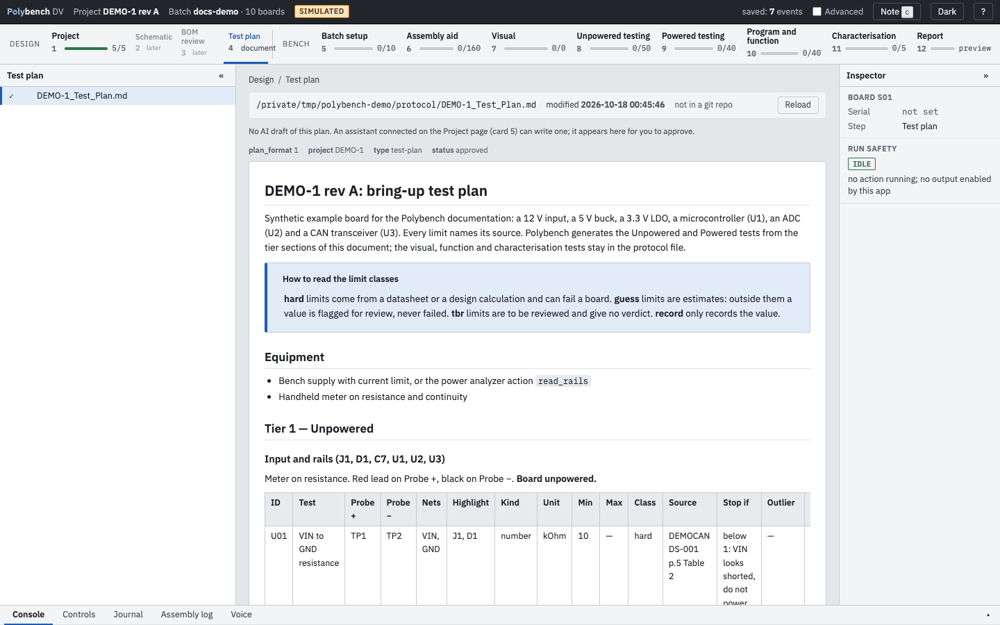
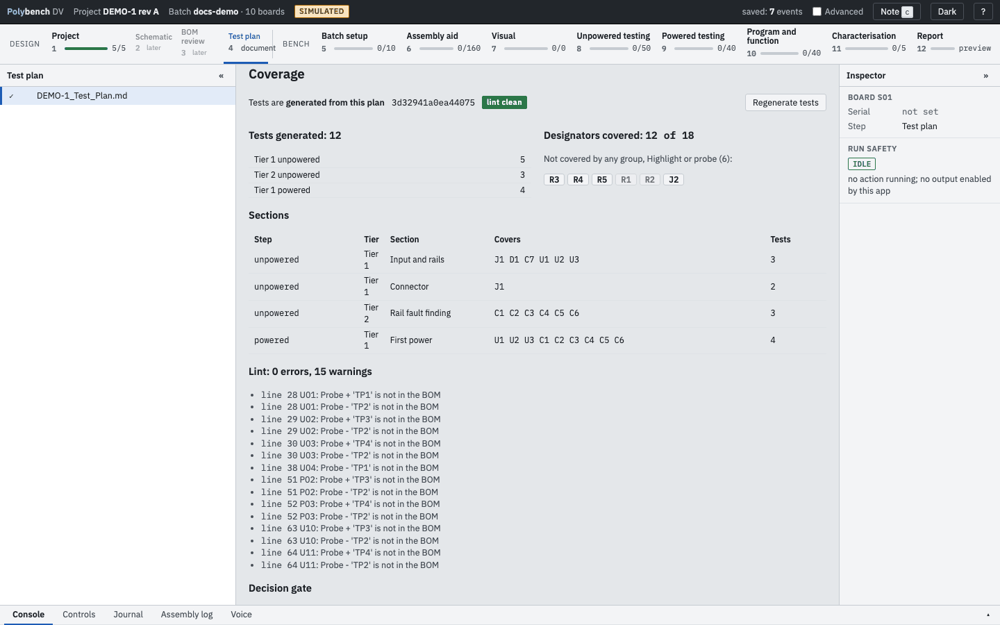

# Step 4: Test plan <span class="badge preview">Preview</span>

**Why:** the plan a person reviews and the tests the bench runs should be the same thing. In Polybench the markdown test plan is the master: the Unpowered and Powered tests, their limits, stop rules, Tier 2 sections and the decision gate are generated from it. Step 4 shows the plan, what was generated from it and what it does not cover.

!!! note "Preview"
    The plan format (`plan_format: 1`), the parser, the lint, the generator and the app behaviour are covered by automated tests and a simulated run. They have not yet been used on a real batch.

{ .shot }

## Two ways to attach a plan

In the top protocol file:

```yaml
# The plan is the master: tests of the steps it defines are generated from it at start
test_plan: {file: DEMO-1_Test_Plan.md, generate: true}

# Or display only: the protocol stays the master and the plan is shown read-only
test_plan: DEMO-1_Test_Plan.md
test_plan_files: [DEMO-1_Test_Plan.md, DEMO-1_Power_Calc.md]
```

Paths are relative to the top protocol file. How to write a plan that Polybench can generate from is in [Writing a test plan](../guides/writing-a-test-plan.md).

## How to

1. Open step 4. The left panel lists the plan documents; the centre renders the selected one.
2. Read the header: the file path, its modification time and, when the file is in a git repository, the last commit that touched it (or "not committed yet"). Front-matter properties are shown on one line above the document.
3. Scroll to **Coverage** under the rendered plan (generated plans only).
4. After editing the plan, press **Regenerate tests**. Polybench reads the plan and the protocol again without a restart. If the new plan has lint errors, the running tests are kept and the errors are listed.

## Coverage

{ .shot loading=lazy }

| Block | Shows |
|---|---|
| Tests generated | per tier and step, for example "Tier 1 unpowered 5, Tier 2 unpowered 3, Tier 1 powered 4" |
| Designators covered | how many BOM designators a group heading, a Highlight or a Probe cell covers, and the list of those that none does (DNF parts are marked) |
| Sections | step, tier, section, the designators it covers and its test count |
| Lint | errors and warnings with their plan line numbers |
| Decision gate | each gate and its rules |
| Retired | tests the plan no longer has, with their recorded results |
| Plan loads | the plan hash and test count each time it was loaded |

## Plan revisions and retired tests

Every load of a plan with a new content hash is journalled as `plan_loaded`. Results are keyed by test ID, so they survive a plan revision. A test that a new revision drops is **retired**: it is listed under "Retired" in its step and in step 4, with its results, and stays in the journal and the report. Re-adding the ID brings the results back. For that reason a test ID is never reused for a different measurement.

The protocol hash does not include the plan, so editing the plan does not raise PROTOCOL CHANGED; it adds a new plan load.

## What the viewer renders

Headings, paragraphs, lists, tables, code blocks, links, images and callouts (`> [!note] Title`). It also understands two conventions of note-taking tools: `%% ... %%` comments are removed from the view, and `[[name]]` or `[[name|label]]` links show as their label and open in the viewer when `name.md` sits next to the plan.

It is safe by construction: every character is escaped before rendering, so raw HTML in the file shows as text and never runs. Links are limited to `http`, `https` and `mailto`. Files over 2 MB are cut at 2 MB. Only markdown files in the plan's own folder can be opened.

## Planned: drafting the plan

<span class="badge planned">Planned</span> Drafting the plan from the schematic and layout analysed in steps [2](schematic-analysis.md) and [3](bom-and-manufacturing.md). Today a person writes the plan, or an assistant connected through the optional AI connector writes a draft that you read as a diff and approve (tested with Claude Code on a simulated batch); step 4 says "Planned: generate this plan for approval from the schematic and layout loaded in step 1."

## Related

- [Writing a test plan](../guides/writing-a-test-plan.md): the format, with the DEMO-1 example
- [Unpowered testing](unpowered-testing.md): tiers, the decision gate and Tier 2 at the bench
- [Command line: polybench plan](../reference/cli.md#polybench-plan)
