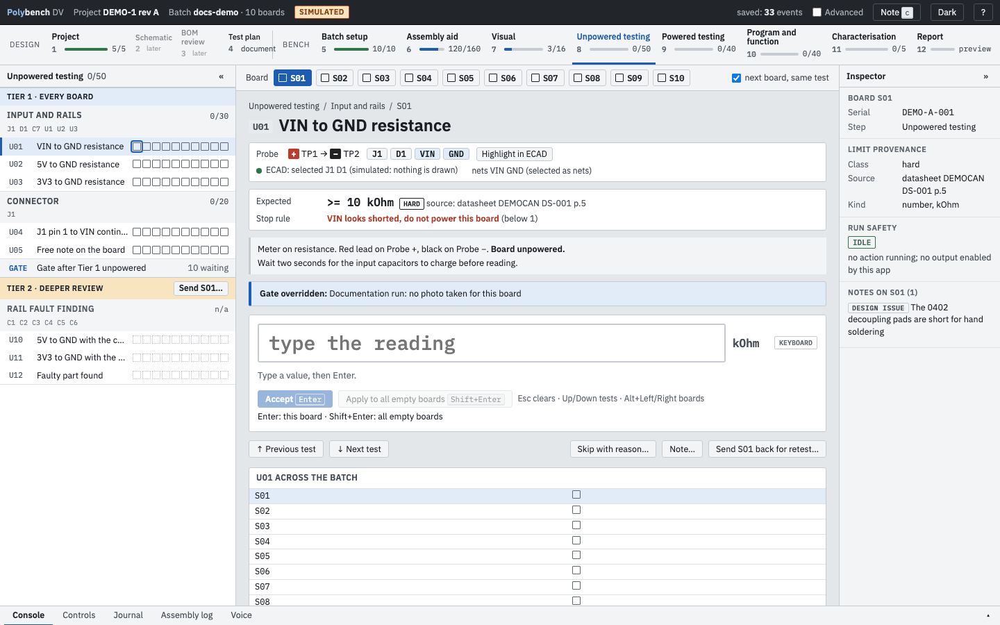
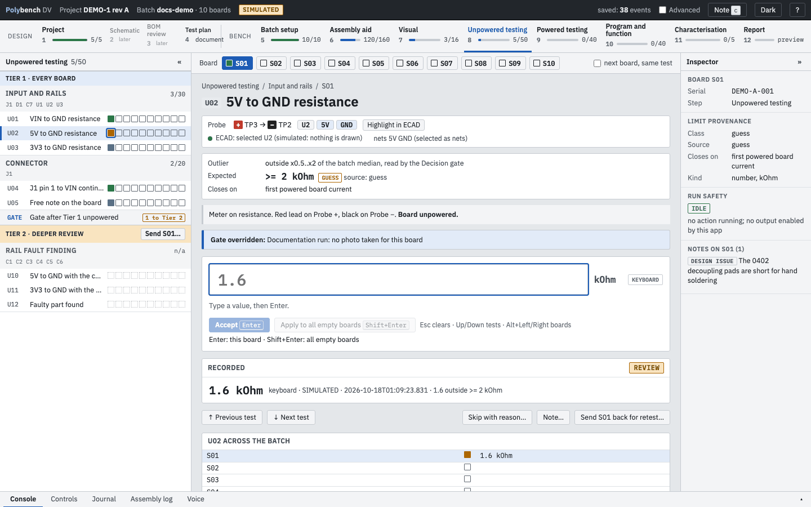
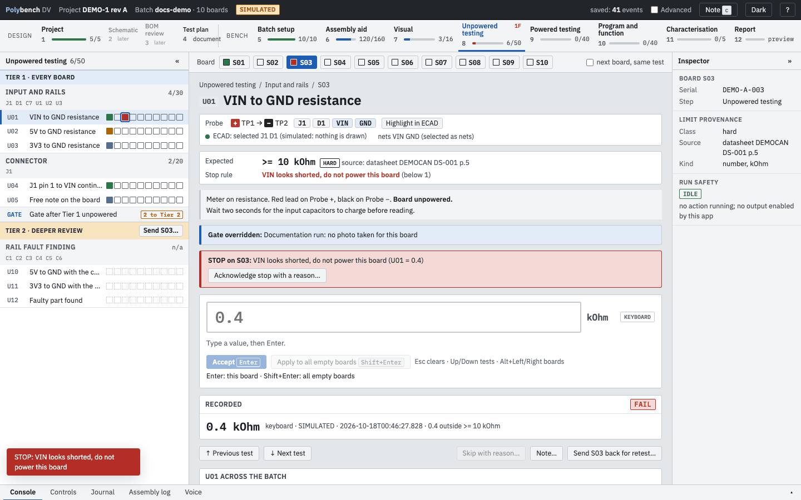
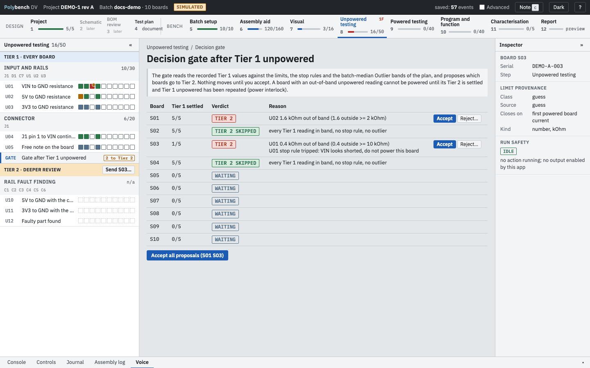
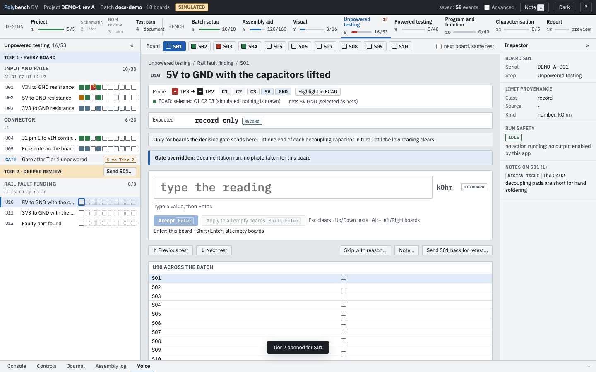

# Step 8: Unpowered testing Ready

**Why:** a short from a rail to ground is the most common way to lose a new board at first power. Measuring rail resistance and key continuities with the board unpowered finds it while it is still harmless.

When the protocol uses a [generated test plan](test-plan.md), this step is organised in **tiers**: Tier 1 for every board, a **decision gate**, and Tier 2 deeper review for the boards the gate sends there. Those parts are Preview. Without a generated plan the step lists the protocol's sections and works the same way minus the gate.

{ .shot }

## How to

1. Pick the board and the test. The step is **gated** on Visual: until the board's visual checks are complete without a FAIL, the focus panel says why and offers **Override with a reason...**.
2. Read the **probe card**: a red `+` and a black `−` mark the meter leads (`+ TP1 → − TP2`). The parts, nets and pins of the test are selected in the ECAD program when the test comes into focus; **Highlight in ECAD** repeats it.
3. Read **Expected**: the limit, its class badge (HARD, GUESS, TBR, RECORD) and its source. **Closes on** tells you what will turn an estimate into a real limit. **Outlier** shows the band against the batch median that the decision gate reads.
4. Type the reading in the unit shown and press Enter.
5. A reading that fails a hard limit, or falls outside a guess limit, needs Shift+Enter (or the **Record FAIL** button). Enter alone will not record it.

{ .shot loading=lazy }

### Row mode

Tier 1 Unpowered runs **one test across all boards, then the next test**: with **next board, same test** ticked, Enter moves to the next open board on the same test. That suits a meter set to one range and probes on one pair of test points. Untick it to walk all tests on one board instead.

### Example on DEMO-1

| Test | Reading | Limit | Result |
|---|---|---|---|
| U01 VIN to GND | 12.5 kOhm | hard, at least 10 kOhm | PASS |
| U02 5V to GND | 1.6 kOhm | guess, at least 2 kOhm | review: outside the estimate, not a FAIL |
| U03 3V3 to GND | 1.2 kOhm | tbr, at least 1 kOhm | no verdict |
| U04 J1 pin 1 to VIN | y | yes | PASS |
| U05 Free note | "clean board" | record | recorded |

## Stop rules

A stop rule protects the board and the bench. On DEMO-1, U01 below 1 kOhm means "VIN looks shorted, do not power this board".

{ .shot loading=lazy }

When a reading trips the rule, the board is blocked, a red banner names the rule and the value, and a message appears. Press **Acknowledge stop with a reason...** and say what you will do ("U3 bridged, reflow and re-measure").

## The decision gate Preview { #the-decision-gate data-toc-label="The decision gate" }

The **GATE** row at the end of Tier 1 opens the gate. For each board whose Tier 1 tests are all settled, the gate proposes a verdict with its reasons:

| Verdict | When |
|---|---|
| TIER 2 | a reading out of band (a hard FAIL, a guess review, a yes/no answered No), a stop rule tripped, or an outlier against the batch median once enough boards are measured |
| TIER 2 SKIPPED | every Tier 1 reading in band, no stop rule, no outlier |
| WAITING | not every Tier 1 test is settled yet |

{ .shot loading=lazy }

Nothing moves until you decide. **Accept** sends the board to Tier 2 and records the reasons; **Reject...** keeps it out with a reason; **Accept all proposals** does every waiting one. **Send S0n to Tier 2...** in the Tier 2 header does it by hand for the current board.

If more than the plan's share of boards (DEMO-1: 50 %) is out of band on one test, the gate says to stop the batch and review before reworking anything: a common fault is more likely a plan or design problem than a build problem.

## Tier 2: deeper review Preview { #tier-2-deeper-review data-toc-label="Tier 2: deeper review" }

Tier 2 sections apply only to the boards sent there. For every other board they are **n/a**: they do not count towards progress, the gates of later steps or the report's open items, and an entry is refused.

{ .shot loading=lazy }

## Retest and the power interlock

After the rework, **Send S01 back for retest...** with the cause and the fix opens attempt 2 of the step. The first attempt's results stay visible under **Earlier attempts** and in the report. The new attempt starts with the board n/a for Tier 2 again.

With `hold power` in the plan's gate, a board with an out-of-band or stopped Tier 1 reading **cannot be powered** until its Tier 2 sections are settled and Tier 1 has been repeated in a retest. The Powered step shows the board as gated; you can override with a reason like any gate.

## Moving around

| Key | Does |
|---|---|
| Enter | Accept the value and move on |
| Shift+Enter | Record a FAIL or a review value |
| Esc | Clear the box |
| Up / Down | Previous or next test |
| Alt+Left / Alt+Right, PageUp / PageDown | Previous or next board |
| `c` | Note on this test and board |

## Correcting a value

Typed the wrong value? Go back to the cell, type the right value and press Enter. The focus panel says "Press Enter again to replace"; the second Enter replaces it. The first value stays in the journal. To leave a test out, press **Skip with reason...**; a skip settles the cell and is listed in the report, never shown as passed.

## Related

- [Concepts: limit classes](../concepts.md#limit-classes)
- [Writing a test plan: decision gate](../guides/writing-a-test-plan.md#the-decision-gate)
- [Powered testing](powered-testing.md), the next step
