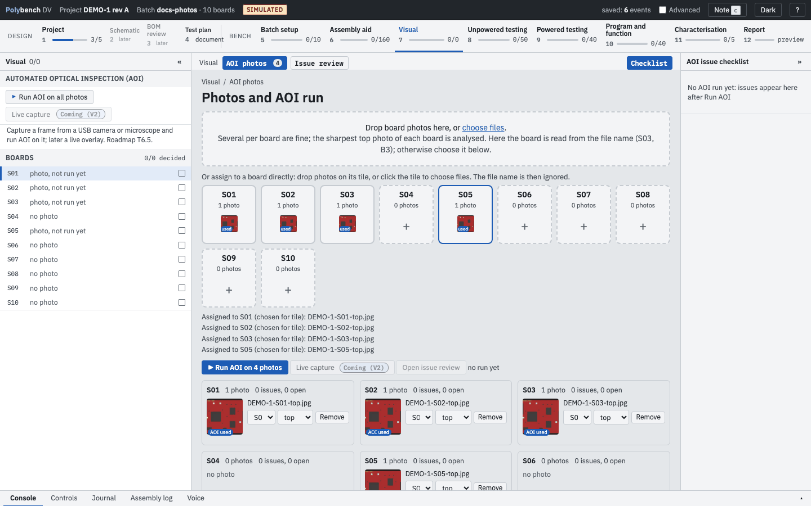
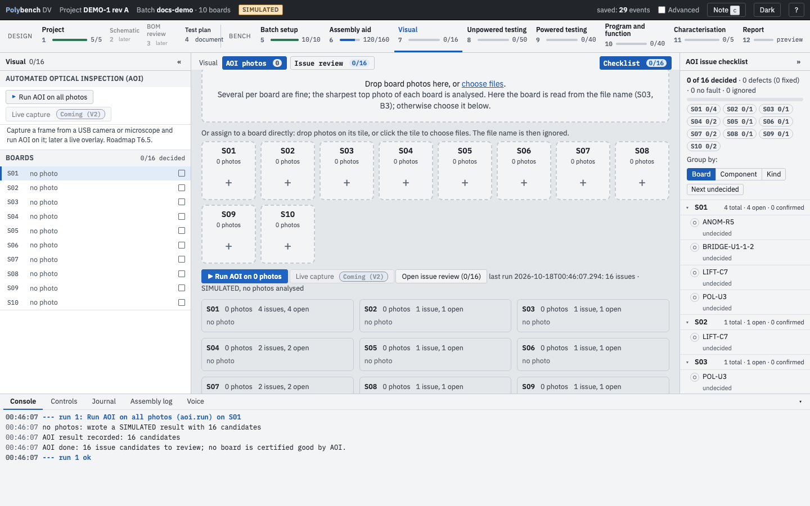
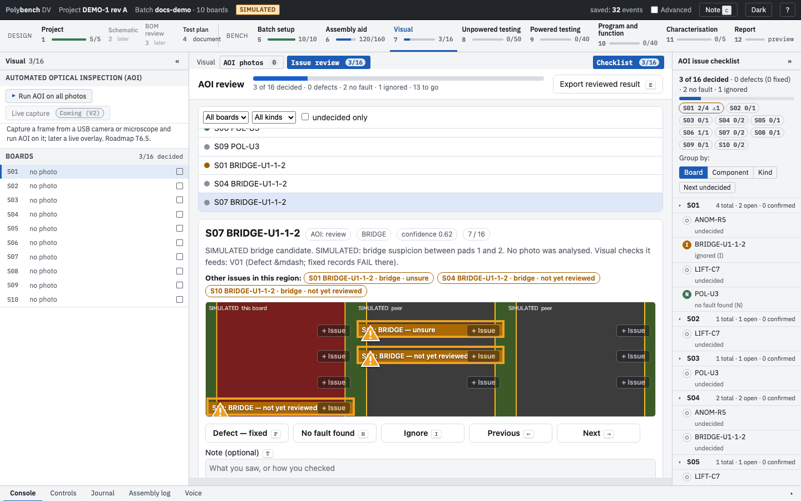
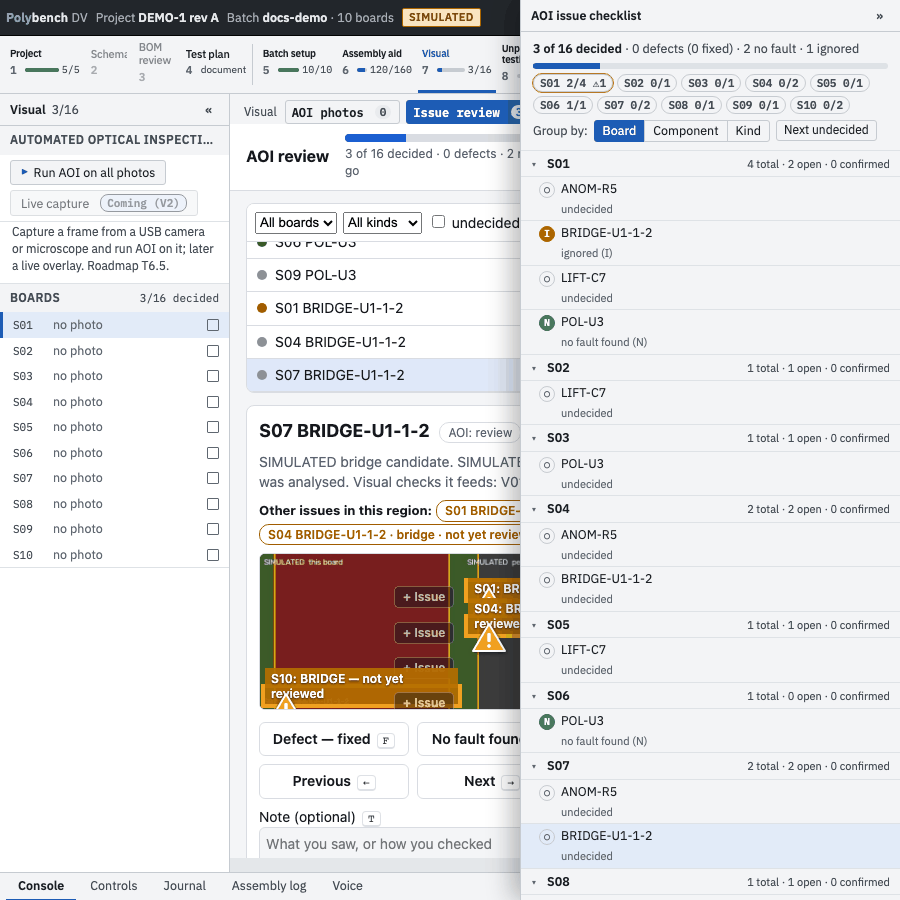

# Step 7: Visual and AOI <span class="badge ready">Ready</span>

**Why:** a solder bridge or a reversed diode found under the lamp costs a minute; found after first power it can cost a board. The Visual step records each check per board, and optional automated optical inspection (AOI) points your eyes at the places most likely to be wrong.

The step is the AOI review. It has two modes, chosen in the bar above the centre: **AOI photos** and **Issue review**. They appear when the protocol has an [`aoi:` block](#set-up-aoi-for-your-board). There is no Yes/No checklist in this step.

A board is **done** when it has a photo, an AOI run covers it and every issue is decided. An undecided issue makes it partial. A **confirmed** issue is a defect: the board shows attention and Unpowered is blocked ("S01 has 1 confirmed AOI issue") until you press **Reworked** on the issue in the checklist, with an optional note. **Unsure** does not block; it shows as a warning in the board's status and in the report. The left panel shows the AOI actions and each board's progress (decided / total, confirmed, unsure). **Live capture** is listed greyed out with a *Coming (V2)* tag: capture a frame from a USB camera or microscope and run AOI on it; later a live overlay.

## AOI photos

AOI is review assistance. It lists candidate defects; your **Y**, **N** or **Unsure** decides. Nothing becomes a PASS because AOI found nothing.

{ .shot }

1. Take a top-side photo of each board.
2. Drop photos on a board's **tile**, or click the tile to choose files. A photo dropped on a tile goes to that board whatever its file name says.
3. Or drop photos on the general area: the board is read from the file name (`-S03`, `-B3` or the batch label), the side from `top` or `bottom`. Photos the app cannot assign land in a "No board" card where you choose the board.
4. Check the thumbnails. Click one for the full-size viewer (arrow keys move through the photos). Drag a thumbnail onto another tile to move it. **Remove** moves the file to `aoi/removed/` with an optional reason and keeps it out of the next run. HEIC photos from a phone are fine.

Several photos per board are allowed. For each board and side the sharpest one is analysed and carries an **AOI used** badge; the others stay as evidence.

## Run AOI

Press **Run AOI on all photos** (left panel) or **Run AOI on N photos**. The run is an action like any other: live console, Abort, evidence in the run folder. It registers each photo to the layout, runs the protocol checks and the defect stage (bridges, missing parts, lifted parts, anomalies compared across the boards) and polarity, then lists the candidates.

{ .shot loading=lazy }

With `--simulate` and no photos, the run produces a synthetic result in which every candidate and image is labelled SIMULATED, so you can practise the review.

## Issue review

{ .shot }

One candidate at a time: the crop, a full-board locator, the same region on the other boards (peers), and other issues in the region. Decide each one:

| Key | Decision | Effect on the visual tests |
|---|---|---|
| `y` | Confirmed defect | Blocks Unpowered for the board until you mark it **Reworked**. |
| `n` | Not a defect | When every candidate touching a test is dismissed, a PASS **proposal** appears on it, which you accept as usual. Never for polarity or lift candidates. |
| `u` | Unsure | Nothing recorded; the test stays open and is listed as an open item in the report. |
| Backspace or `0` | Clear the decision | Undoes only what this decision set. |

Candidates are matched to tests by the designators in the test's `highlight` list and the words of its title, or by an explicit `aoi:` list on the test.

Other review keys: Right / Left or `j` / `k` next and previous, `t` or `/` add a note, `f` fit the crop, `e` export the reviewed result. Space or `b` opens the **board view** of the registered photo; in it `s` toggles the silkscreen overlay, the wheel zooms, drag pans, `r` refits and `i` toggles **add mode**.

**+ Issue** on any board (or `i` in the board view, then drag a box) adds a defect AOI missed. It is confirmed at once, fails the matching test, is marked "added by you" and is written to `aoi/labels.jsonl` as an AOI miss for later training.

## The AOI issue checklist

The right panel lists every issue grouped by **Board**, **Component** or **Kind**, with counts of total, open and confirmed. **Next undecided** jumps to the next open one; a click on an item opens it in the review. On a narrow window open it with the **Checklist** chip.

{ .shot loading=lazy }

## Rules that keep AOI honest

- A decision counts only for the run it was made on, or for a later run whose evidence is byte-identical. A re-run otherwise starts undecided.
- Polarity fails closed: an undecided polarity candidate says "look by eye" and is never turned into a pass.
- Lifted-part detection is review only.
- The pipeline is tuned for a red solder mask. The first photo's red-mask fraction is measured; below 0.15 a warning is shown in the view, the console and the run record.

## Set up AOI for your board

Add an `aoi:` block to a protocol fragment:

```yaml
aoi:
  protocol: aoi_protocol.json   # checks, classes, thresholds (schema polystage.aoi_protocol/0)
  layout: layout.json           # parts, inspection polygons, outline
  cam_zip: /path/to/board.zip   # optional: the released CAM package; the layout is verified against its pick-and-place
```

Paths are relative to the file that holds the block. With the block present, the Visual step gains the AOI section and modes.

`polybench aoi-derive` builds the layout, the AOI protocol and a gaps list from a CAM package and the BOM fragment:

```bash
polybench aoi-derive --cam-zip board.zip --assembly assembly.yaml --design DEMO-1 --out-dir aoi/
```

`GAPS.txt` lists what could not be derived (for example nets or polarity marks), and therefore what AOI cannot check on that board.

The documentation's demo uses a hand-made synthetic layout: `site/examples/demo-docs/aoi/`.

## What is recorded

Each photo (board, side, file, hash, how it was assigned), moves and removals, each run (candidates, counts, notes) and each decision (who, AOI value, confidence, tests failed or cleared). The [Report](report.md) has an AOI section with the run, photos, per-board counts, the issue list and open items.

## Not yet available

The **Label Studio export (advanced)** button is a stub: the export modules exist, the action does not run yet.
